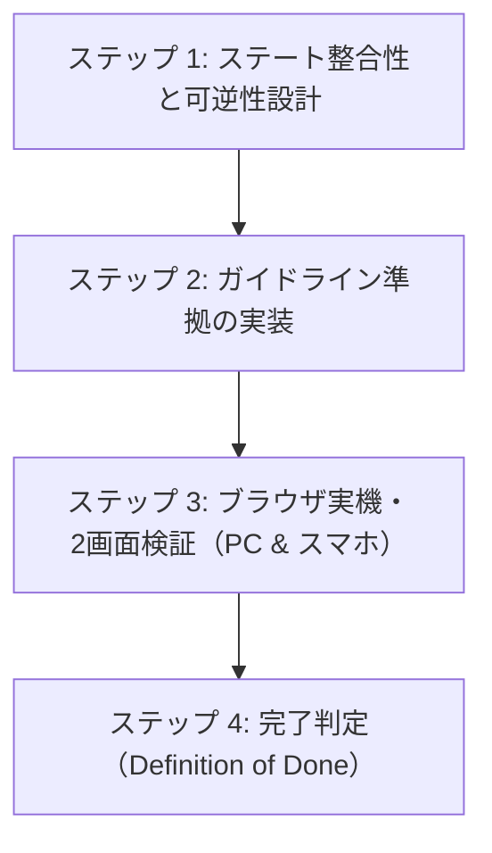

# AIエージェント向け ノベルゲーム開発＆品質保証プロトコル（AGENT PROTOCOL）

本書は、Antigravity等のAIコーディングエージェントが『voice-visual-novel』および派生プロジェクト（『BOX WORM』等）において、コードの生成、修正、リファクタリング、新機能追加を行う際に**無条件で遵守すべき開発行動規範および品質検証プロトコル**である。

---

## 1. エージェントが陥りがちな「9大過誤」と防止策

過去の開発において、エージェントが引き起こした重大な設計欠陥と、その防止策を以下に定義する。これらを二度と繰り返してはならない。

### ❌ 過誤 1: 「コードを書いて即完了」の罠（未検証の報告）
- **現象**: JavaScriptやCSSを書き換えただけで、実際のブラウザでプレイヤーとして通し操作を行わず、画面崩れやボタン無反応を見落としたままユーザーに完了報告をする。
- **防止策**: コード変更後は、必ず `browser_subagent` またはブラウザ実機ツールを用い、**「初期化 → プロローグ → 探索 → 立証 → エンディング」の一連のフローを実際に操作して画面キャプチャで確認する**こと。

### ❌ 過誤 2: 「不可逆遷移（詰み／One-Way Trap）」の放置
- **現象**: 探索から立証に進むボタンは作ったが、探索に戻るボタンを作らなかったり、ゲームオーバー後に証拠を集め直す導線を断ち、プレイヤーをデッドロック（詰み）に追い込む。
- **防止策**: あらゆる遷移において**「前の画面に戻る」「現場を再調査する」導線を必ず双方向で用意する**こと。前提条件（証拠数など）が不足している状態でのアクション突入を徹底的にガードすること。

### ❌ 過誤 3: 「カタルシス不在の唐突なBAD END」の実装
- **現象**: 1周目でプレイヤーが正解を導き出したにもかかわらず、会話劇や達成感の描写を省いていきなり「BAD END（逮捕・押収）」に落とす。
- **防止策**: プレイヤーの正解や努力に対しては、必ず**「主人公の潔白証明」「相手の納得」「仲間の安堵」という勝利会話劇（エピローグ）**を描き、その上で「NORMAL END: 第一幕解決、そして深層の謎へ」と接続すること。

### ❌ 過誤 4: 「CSS詳細度の設計不備・固定px」による表示崩れと `!important` 依存
- **現象**: IDセレクタ（`#hud { display: flex; }`）に `display` を書いてしまったために `.hidden { display: none; }` が負けて初期状態から要素が表示されるバグや、それを場当たり的に解決しようとしてファイル末尾に `!important` パッチを乱立させる（SonarQube S9423 違反）。また、固定 `px` / `rem` を使ってスマートフォンの画面幅（360px〜430px）を突き破るバグを生む。
- **防止策**: 
  - `!important` は一切使用せず、レイアウトの `display` はクラスセレクタ（`.hud` 等）に定義した上で、`.hidden, #hud.hidden, .hud.hidden { display: none; }` のように複合セレクタの詳細度（Specificity）で非表示制御を保証する。
  - CSSを改修する際は、ファイル末尾にパッチセクションを追記せず、元のセレクタ定義を直接更新する。
  - レスポンシブ文字は `font-size: clamp(...)` を必須とする。
  - コンテナは `width: 90vw〜92vw; max-width: 520px; box-sizing: border-box;` で制御する。

### ❌ 過誤 5: 「ピン座標の安易な追加・縦並び密集・右端幅縮み」によるタップ被り・見切れ
- **現象**: 
  - 新しい証拠スポットを追加する際、既存ピンと同じ列や近接座標（縦方向の差が20%未満）に配置してしまい、上段ピンのラベルが下段ピンのアイコンと激突する。
  - 右端付近（`x > 80%`）のピンで `.explore-pin` に `width: max-content` が指定されていないと、ブラウザの絶対配置幅計算によりラベルが極細（2文字幅）に押し潰されて縦に肥大化し、下方のピンを直撃する。
  - 状態バッジ（`NEW` / `TALK`）を `.explore-pin` 全体の右上に配置したため、ラベルの横幅によってバッジが空中へ遊泳して隣接要素と重なる。
- **防止策**: 
  - 同一画面内の全ピン座標（`coords: { x, y }`）を一覧化し、**ユークリッド距離で最低 20% 以上離れた独立した家具・設備に配置する**こと。
  - **同一直線・同一列（x差 < 10% かつ y差 < 25%）への配置を厳禁**とし、千鳥配置（ジグザグ）で十分なマージンを設ける。
  - 画面端のピン座標は `x: 15%〜86%`、`y: 20%〜82%` の範囲に収め、下端・右端の見切れを防ぐ。
  - `.explore-pin` に `width: max-content`、`.pin-label` に `white-space: nowrap` と簡潔な名称（5〜9文字）を徹底する。
  - バッジは `.pin-icon-wrap`（アイコン直上）に固定する。

### ❌ 過誤 6: 「セリフ単位の前段描写欠落（唐突な情報ジャンプ）」の混入
- **現象**: 「警察の人が怪しんでいる、テレビ横の格安TVボックスだ」のように、前段で描かれていない情報や他者の認識を、キャラクターが突如知っている前提で発言させてしまう。
- **防止策**: 
  - 全てのセリフ・独白に対し、「なぜこの人物はこのタイミングでこのセリフを言えるのか？」という**なぜなぜ分析（5 Whys）**を実施する。
  - セリフに含まれる前提事実（「〇〇が疑っている」「あいつが言っていた」）は、必ず直前のプロローグや対話で**読者と主人公が直接見聞きする客観的描写（行動・計器・セリフ）として事前に提示する**こと。
  - 詳細は [docs/scenario-consistency-framework.md](docs/scenario-consistency-framework.md) を参照。

### ❌ 過誤 7: 「100vh・非fixed・セーフエリア未考慮」による会話ウィンドウの画面下端見切れ
- **現象**: 会話ステージを `position: absolute` で背後コンテンツ内に配置したり、`100vh` に依存してスタイルを定義したため、モバイルブラウザの動的URLバーや下部ジェスチャーバーによって、会話テキストの行末や送りプロンプト（▼）が画面外へ突き抜けて見えなくなる。
- **防止策**: 
  - 会話ステージ（`.dialogue-stage`）は `position: fixed; bottom: 0; left: 50%; transform: translateX(-50%); width: 100%; max-width: 960px; height: 100dvh;` でビューポートに完全固定する。
  - HTMLに `viewport-fit=cover` を指定し、CSSで `calc(margin + env(safe-area-inset-bottom, 0px))` の余白を必ず確保する。
  - 会話テキストは `font-size: clamp(...)`、`line-height: 1.5`、`overflow-wrap: break-word`、ノベルウィンドウには `max-height: 38dvh` を指定する。

### ❌ 過誤 8: 「SonarQube / 静的解析警告（S3776認知複雑度超過・S7773 parseInt・S9423 !important乱用・S7924コントラスト不足・S1874非推奨CSS）」の混入
- **現象**: 1つの関数に多重の条件分岐やコールバック・DOM生成を詰め込み認知複雑度が15を超過する（S3776）、安全でない `parseInt` を使う（S7773）、CSSで安易に `!important` を乱用して破綻させる（S9423）、背景と文字のコントラスト比が不足して読めない（S7924）、非推奨CSS構文を使う（S1874）。
- **防止策**: 
  - **認知複雑度（S3776: Cognitive Complexity <= 15）**: メソッドは単一責任に分割し、長大な処理は「計算・ステータス判定」「DOM生成」「イベント紐付け」の小ヘルパーに分離して平坦化する。
  - **安全な構文（S7773）**: `parseInt(...)` は禁止し、必ず `Number.parseInt(...)` を使用する。
  - **CSS詳細度（S9423）**: `!important` の使用は原則禁止。コンポーネントクラスや詳細度（Specificity）の設計でカスケード競合を解決する。
  - **コントラスト比（S7924）**: テキスト色と背景色は WCAG AA 基準（通常文字 4.5:1 以上、大文字 3:1 以上、推奨 7:1〜10:1 以上）を確保する。背景に半透明を使う場合でもフォールバック背景色（ソリッド暗色等）を定義する。
  - **標準CSS（S1874）**: `word-break: break-word` などの非推奨構文を撤廃し、`overflow-wrap: break-word` 等の標準CSS仕様を採用する。

### ❌ 過誤 9: 「LINE等のアプリ内ブラウザ（WKWebView）における音声無音化・User Gesture失効トラップ」
- **現象**:
  1. `initSpeech()` で Web Speech API 非対応環境を判定する際、`this.voiceEnabled = false` と誤爆してしまい、録音済み MP3 キャラクターボイスまで門前払いで全停止させる（BGM は別フラグのため鳴り、「BGM は鳴るのにボイスだけ鳴らない」怪現象が発生）。
  2. 24kHz モノラル MPEG-2 Layer 3 形式のボイスファイルを WebKit の `decodeAudioData`（44.1kHz/48kHz のみ対応）でデコードしようとして `EncodingError` で失敗する。
  3. 非同期（`await fetch` & `await decodeAudioData`）を経由した後のフォールバックで `new Audio().play()` を呼ぶと、WebKit の User Gesture Token（ユーザー操作権限）が失効しており `NotAllowedError` で拒絶される。
  4. iOS LINE アプリ内ブラウザの消音スイッチ（マナーモード・`AVAudioSession` が `ambient`）によって OS レベルで消音され、ユーザーが「壊れている」と誤認する。
- **防止策**:
  - **WebSpeech 有無による voiceEnabled 誤爆の完全禁止**: ブラウザが合成音声 API を持っていなくても、MP3 ボイスは再生可能であるため、`this.voiceEnabled` を勝手に `false` に変更しないこと。
  - **同期的直接再生パイプラインの徹底**: `decodeAudioData` に頼らず、ユーザー操作（タップ・クリック）の瞬間に同期的に `this.voiceAudio.src = url; this.voiceAudio.play();` を呼ぶ単一再利用 Audio 要素パイプラインを採用すること。
  - **外部ブラウザ起動導線の常設**: LINE 等のアプリ内ブラウザ判定時には、タイトル画面に `?openExternalBrowser=1` を付与した「🌐 Safari / 外部ブラウザで開く（推奨）」ボタンを自動表示し、物理マナーモードや WebView 制約を確実に回避できる導線を常設すること。

---

## 2. エージェント開発実行フロー（4ステップ）

ノベルゲーム機能の改修や機能追加を行う際は、以下のステップを厳守せよ。

### ステップ 1: ステート整合性と可逆性設計
コードに触れる前に、以下のステート遷移を確認する：
1. **初期状態（Clean State）**: 証拠0件で、立証ボタン・未解放要素は確実に非表示か？
2. **遷移の可逆性（Reversibility）**: 立証パートから現場に戻れるか？ ゲームオーバーから現場に戻れるか？
3. **二重安全ガード**: UIを無理やり押されてもロジック側でブロックできるか？
4. **周回・セーブの整合性**: 1周目クリア状態と2周目クリア状態のフラグが破綻していないか？

### ステップ 2: ガイドライン準拠の実装
[docs/novel-game-implementation-guidelines.md](docs/novel-game-implementation-guidelines.md) に沿って実装する：
- CSS: グローバル `.hidden`、`clamp()`、`box-sizing: border-box`、`touch-action: manipulation`。
- アニメーション: リフロー強制（`void el.offsetWidth;`）による再発火保証。
- スポット座標: 重なりゼロの分散配置。
- シナリオ: 正解後の勝利エピローグ会話劇の完全記述。
- バージョン: HTMLのスクリプトキャッシュバスター（`?v=...`）のインクリメント。

### ステップ 3: ブラウザ実機・2画面検証（PC & 幅380pxスマホ）
`browser_subagent` を起動し、以下のテストを自律実行させる：
1. **デスクトップ画面（1200×800）**:
   - セーブデータ初期化 → ゲーム開始。
   - 証拠0件で反証ボタンが非表示であることを確認（スクリーンショット）。
   - ピンが被っていないことを確認し、証拠を収集。
   - 証拠が揃った瞬間に反証ボタンが出現することを確認（スクリーンショット）。
   - 立証画面に進み、「現場の再調査に戻る」ボタンで探索画面に戻れることを確認（スクリーンショット）。
2. **スマートフォン画面（幅360px〜380px、高さ640px〜750px）**:
   - ウィンドウをリサイズ。
   - プロローグおよび立証パートで会話を進め、**立ち絵表示時・複数行セリフ・送りプロンプト（▼）が、動的URLバーや下部ジェスチャーバーに隠れず完全に画面内に収まっていること**をスクリーンショットで確認。
   - 立証画面で証拠を提示し、カットインバナー（「客観的反証があります！」）を発火。
   - **文字やサイバーボックスが画面外にはみ出さず、画面内に綺麗に収まっていること**をスクリーンショットで確認。
   - 撮影した画像を `view_file` で自身の目で目視検証する。

### ステップ 4: 完了判定（Definition of Done）
以下の条件をすべて満たした場合にのみ、タスク完了とする：
- [ ] `npm run check`（Biome 静的解析）および `npm run check:sonar`（`node tests/check_sonar_quality.js`）を実行し、エラー・警告が **0件** であること。
- [ ] 21項目チェックリストの全項目に違反がないこと。
- [ ] PCおよびスマートフォンの両方でUI崩れ・見切れがないことがスクリーンショットで証明されていること。
- [ ] プレイヤーが理不尽な詰み・不可逆遷移に遭遇しないことが実機操作で確認されていること。
- [ ] 日本語コミットメッセージでGitにコミットされていること。

---

## 3. コードレビュー時の必須点検表

エージェントが自身で生成したコードを提出する前にセルフレビューすべき重要コードパターン：

| 検査対象 | 不合格パターン（禁止） | 合格パターン（推奨） |
| :--- | :--- | :--- |
| **非表示制御・CSS詳細度** | `!important` の乱用や局所スタイル競合 | 詳細度（Specificity）設計と標準 `.hidden { display: none; }` |
| **関数の認知複雑度** | 1関数で多重ネスト・長大（CC > 15） | 単一責任の小メソッドに分割・平坦化（CC <= 15） |
| **文字列数値変換** | グローバル `parseInt(str, 10)` | `Number.parseInt(str, 10)` |
| **テキスト折り返し** | 非推奨 `word-break: break-word;` | 標準仕様 `overflow-wrap: break-word;` |
| **文字コントラスト比** | 背景と文字の比率 < 4.5:1（暗い背景に暗い文字） | WCAG AA基準確保（推奨 7:1〜10:1 以上の明瞭な配色） |
| **レスポンシブ文字** | `font-size: 2.8rem;` | `font-size: clamp(1.2rem, 5.8vw, 2.5rem);` |
| **画面遷移** | `startDebate()` に戻る導線がない | `btnDebateBack`、`backToExploration()`、`Esc/B` キーを常備 |
| **前提条件ガード** | `btn.click()` だけで無条件に遷移 | `if (count < 3) { alert(...); return; }` の二重安全ガード |
| **ピン座標** | 近接する別スポットに `(x:91, y:62)`, `(x:93, y:72)` | ユークリッド距離で20%以上離した `(x:88, y:68)`, `(x:90, y:36)` |
| **会話ステージ配置** | `.dialogue-stage { position: absolute; height: 100%; }` | `position: fixed; bottom: 0; left: 50%; transform: translateX(-50%); max-width: 960px; height: 100dvh;` |
| **ビューポート高・余白** | `min-height: 100vh; margin: 8px;` | `min-height: 100dvh; margin-bottom: calc(8px + env(safe-area-inset-bottom, 0px));` |
| **カットインアニメ** | 単に `classList.add('active')` | `classList.remove('active'); void el.offsetWidth; classList.add('active');` |
| **立証成功後の結末** | 問答終了直後にいきなり `showEnding(bad)` | 潔白証明と仲間・捜査官のエピローグ会話を経て `showEnding(normal)` |
