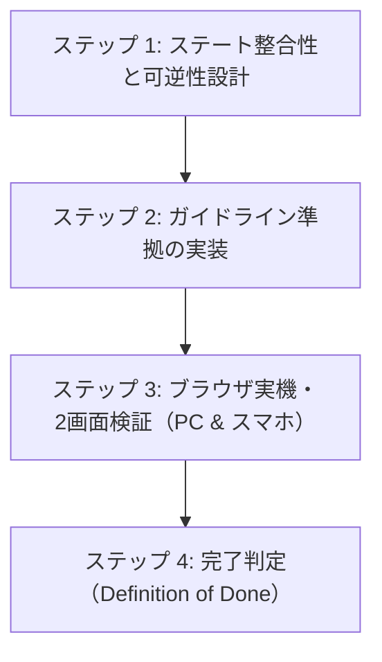

# AIエージェント向け ノベルゲーム開発＆品質保証プロトコル（AGENT PROTOCOL）

本書は、Antigravity等のAIコーディングエージェントが『voice-visual-novel』および派生プロジェクト（『BOX WORM』等）において、コードの生成、修正、リファクタリング、新機能追加を行う際に**無条件で遵守すべき開発行動規範および品質検証プロトコル**である。

---

## 1. エージェントが陥りがちな「5大過誤」と防止策

過去の開発において、エージェントが引き起こした重大な設計欠陥と、その防止策を以下に定義する。これらを二度と繰り返してはならない。

### ❌ 過誤 1: 「コードを書いて即完了」の罠（未検証の報告）
- **現象**: JavaScriptやCSSを書き換えただけで、実際のブラウザでプレイヤーとして通し操作を行わず、画面崩れやボタン無反応を見落としたままユーザーに完了報告をする。
- **防止策**: コード変更後は、必ず `browser_subagent` またはブラウザ実機ツールを用い、**「初期化 → プロローグ → 探索 → 立証 → エンディング」の一連のフローを実際に操作して画面キャプチャで確認する**こと。

### ❌ 過誤 2: 「不可逆遷移（詰み／One-Way Trap）」の放置
- **現象**: 探索から立証に進むボタンは作ったが、探索に戻るボタンを作らなかったり、ゲームオーバー後に証拠を集め直す導線を断ち、プレイヤーをデッドロック（詰み）に追い込む。
- **防止策**: あらゆる遷移において**「前の画面に戻る」「現場を再調査する」導線を必ず双方向で用意する**こと。前提条件（証拠数など）が不足している状態でのアクション突入を徹底的にガードすること。

### ❌ 過誤 3: 「カタルシス不在の唐突なBAD END」の実装
- **現象**: 1周目でプレイヤーが正解を導き出したにもかかわらず、会話劇や達成感の描写を省いていきなり「BAD END（逮捕・押収）」に落とす。
- **防止策**: プレイヤーの正解や努力に対しては、必ず**「主人公の潔白証明」「相手の納得」「仲間の安堵」という勝利会話劇（エピローグ）**を描き、その上で「NORMAL END: 第一幕解決、そして深層の謎へ」と接続すること。

### ❌ 過誤 4: 「個別セレクタ依存・固定px」による表示崩れ
- **現象**: `.hidden` クラスを要素ごとの個別セレクタ（例: `.hud-debate-btn.hidden`）に頼って書き漏らし、初期状態からボタンが表示されるバグや、固定 `px` / `rem` を使ってスマートフォンの画面幅（360px〜430px）を突き破るバグを生む。
- **防止策**: 
  - グローバルに `.hidden { display: none !important; }` を最優先定義する。
  - レスポンシブ文字は `font-size: clamp(...)` を必須とする。
  - コンテナは `width: 90vw〜92vw; max-width: 520px; box-sizing: border-box;` で制御する。

### ❌ 過誤 5: 「ピン座標の安易な追加」によるタップ被り
- **現象**: 新しい証拠スポットを追加する際、既存のピンと同じ場所（または隣接する数%以内）に配置してしまい、ラベルやピンが折り重なってクリックできなくなる。
- **防止策**: 同一画面内の全ピン座標（`coords: { x, y }`）を一覧化し、**ユークリッド距離で最低 15%〜20% 以上離れた独立した家具・設備に配置する**こと。

---

## 2. エージェント開発実行フロー（4ステップ）

ノベルゲーム機能の改修や機能追加を行う際は、以下のステップを厳守せよ。

### ステップ 1: ステート整合性と可逆性設計
コードに触れる前に、以下のステート遷移を確認する：
1. **初期状態（Clean State）**: 証拠0件で、立証ボタン・未解放要素は確実に非表示か？
2. **遷移の可逆性（Reversibility）**: 立証パートから現場に戻れるか？ ゲームオーバーから現場に戻れるか？
3. **二重安全ガード**: UIを無理やり押されてもロジック側でブロックできるか？
4. **周回・セーブの整合性**: 1周目クリア状態と2周目クリア状態のフラグが破綻していないか？

### ステップ 2: ガイドライン準拠の実装
[novel-game-implementation-guidelines.md](file:///d:/Work/voice-visual-novel/docs/novel-game-implementation-guidelines.md) に沿って実装する：
- CSS: グローバル `.hidden`、`clamp()`、`box-sizing: border-box`、`touch-action: manipulation`。
- アニメーション: リフロー強制（`void el.offsetWidth;`）による再発火保証。
- スポット座標: 重なりゼロの分散配置。
- シナリオ: 正解後の勝利エピローグ会話劇の完全記述。
- バージョン: HTMLのスクリプトキャッシュバスター（`?v=...`）のインクリメント。

### ステップ 3: ブラウザ実機・2画面検証（PC & 幅380pxスマホ）
`browser_subagent` を起動し、以下のテストを自律実行させる：
1. **デスクトップ画面（1200×800）**:
   - セーブデータ初期化 → ゲーム開始。
   - 証拠0件で反証ボタンが非表示であることを確認（スクリーンショット）。
   - ピンが被っていないことを確認し、証拠を収集。
   - 証拠が揃った瞬間に反証ボタンが出現することを確認（スクリーンショット）。
   - 立証画面に進み、「現場の再調査に戻る」ボタンで探索画面に戻れることを確認（スクリーンショット）。
2. **スマートフォン画面（幅380px、高さ750px）**:
   - ウィンドウをリサイズ。
   - 立証画面で証拠を提示し、カットインバナー（「客観的反証があります！」）を発火。
   - **文字やサイバーボックスが画面外にはみ出さず、画面内に綺麗に収まっていること**をスクリーンショットで確認。
   - 撮影した画像を `view_file` で自身の目で目視検証する。

### ステップ 4: 完了判定（Definition of Done）
以下の条件をすべて満たした場合にのみ、タスク完了とする：
- [ ] 20項目チェックリストの全項目に違反がないこと。
- [ ] PCおよびスマートフォンの両方でUI崩れ・見切れがないことがスクリーンショットで証明されていること。
- [ ] プレイヤーが理不尽な詰み・不可逆遷移に遭遇しないことが実機操作で確認されていること。
- [ ] 日本語コミットメッセージでGitにコミットされていること。

---

## 3. コードレビュー時の必須点検表

エージェントが自身で生成したコードを提出する前にセルフレビューすべき重要コードパターン：

| 検査対象 | 不合格パターン（禁止） | 合格パターン（推奨） |
| :--- | :--- | :--- |
| **非表示制御** | `.some-btn.hidden { display: none; }` のみ | グローバル `.hidden { display: none !important; }` を併用 |
| **レスポンシブ文字** | `font-size: 2.8rem;` | `font-size: clamp(1.2rem, 5.8vw, 2.5rem);` |
| **画面遷移** | `startDebate()` に戻る導線がない | `btnDebateBack`、`backToExploration()`、`Esc/B` キーを常備 |
| **前提条件ガード** | `btn.click()` だけで無条件に遷移 | `if (count < 3) { alert(...); return; }` の二重安全ガード |
| **ピン座標** | 近接する別スポットに `(x:91, y:62)`, `(x:93, y:72)` | ユークリッド距離で20%以上離した `(x:88, y:68)`, `(x:90, y:36)` |
| **カットインアニメ** | 単に `classList.add('active')` | `classList.remove('active'); void el.offsetWidth; classList.add('active');` |
| **立証成功後の結末** | 問答終了直後にいきなり `showEnding(bad)` | 潔白証明と仲間・捜査官のエピローグ会話を経て `showEnding(normal)` |
