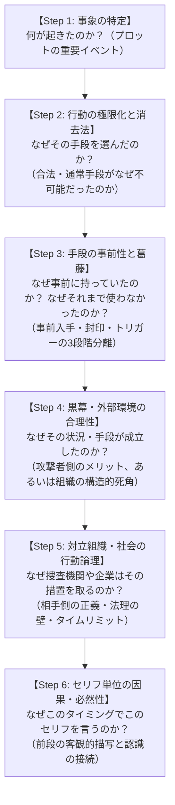

# シナリオ整合性フレームワーク (Scenario Consistency Framework)
― 「なぜなぜ分析」と「ゲーム理論・情報非対称性」による物語の矛盾排除と論理的深化の実践ガイド ―

本書は、アドベンチャーゲーム、ミステリー、SF、電脳サスペンス等のシナリオ制作において、**「ご都合主義」「論理的矛盾」「メタ視点の漏洩」「専門用語による置いてけぼり」を未然に排除し、プレイヤー・読者が深く納得・共感できる高純度の物語を構築するための汎用フレームワーク**である。

特定の作品や題材に依存せず、あらゆる新規シナリオ作成・既存シナリオ推敲・実在事件のノベル化において共通の設計基準として適用する。

---

## 目次
1. [フレームワークの基本思想](#1-フレームワークの基本思想)
2. [シナリオにおける「8大破綻パターン」と検出チェックリスト](#2-シナリオにおける8大破綻パターンと検出チェックリスト)
3. [「なぜなぜ分析（5 Whys）」による整合性構築の6段階プロセス](#3-なぜなぜ分析5-whysによる整合性構築の6段階プロセス)
4. [対話設計・情報非対称性・専門用語伝達の4大原則](#4-対話設計情報非対称性専門用語伝達の4大原則)
5. [主人公の専門性・行動倫理と「構造的死角」の両立原則](#5-主人公の専門性行動倫理と構造的死角の両立原則)
6. [対立組織のエスカレーションと「ゲーム理論的インセンティブ逆転」の原則](#6-対立組織のエスカレーションとゲーム理論的インセンティブ逆転の原則)
7. [周回・フェーズ進行における記憶継承と「解決手段の内在化」原則](#7-周回フェーズ進行における記憶継承と解決手段の内在化原則)
8. [作品別ケーススタディ・アーカイブ（理論の実践適用例）](#8-作品別ケーススタディアーカイブ理論の実践適用例)
9. [他作品への応用：再利用可能なシナリオ検証ワークシート（汎用21問）](#9-他作品への応用再利用可能なシナリオ検証ワークシート汎用21問)

---

## 1. フレームワークの基本思想

物語の面白さは「意外性やドラマチックな展開」から生まれるが、物語への**信頼（リアリティと没入感）は「必然性と論理的整合性」**から生まれる。

```
［感情のドラマ（動機・葛藤・カタルシス）］ × ［冷徹な論理（物理的・技術的・法制度的・経済的制約）］ ＝ 傑作シナリオ
```

「作者の都合で起きたイベント（ご都合主義）」を「登場人物の動機と世界の力学（技術仕様・法制度・インセンティブ構造）から必然的に起きざるを得なかった事象」へと昇華させること。それが本フレームワークの目的である。

---

## 2. シナリオにおける「8大破綻パターン」と検出チェックリスト

シナリオの違和感は、主に以下の8つの不整合から発生する。プロット作成時および推敲時に必ずこのチェックリストで点検する。

| # | パターン | 典型的な違和感・穴 | 点検問いかけ（悪魔の代弁者） |
| :--- | :--- | :--- | :--- |
| **1** | **時系列・物理的タイムラインの破綻** | 突発的な危機が発生している最中に、その場で物や手段を手配・開発して間に合わせている | 「その緊急事態の数分〜数時間の間に、どうやってそれを手配・入手・適用できたのか？ 事前準備なしに間に合うはずがないのでは？」 |
| **2** | **動機と代償の不均衡** | 重大なリスク（法違反、命の危険、巨額損失）に対し、行動動機が弱すぎる／他の安全な選択肢を安易に無視している | 「なぜ警察や医者、弁護士など正規の手段を使わなかったのか？ 他の安全な選択肢はなぜ全て潰れていたのか？」 |
| **3** | **社会・技術的波及の無視** | 危険な道具や裏ツール、脆弱性が一般社会に無防備に放置されている | 「そんな危険なものが容易に出回っているなら、なぜ世間で社会問題や法規制、メーカーの全国リコールになっていないのか？」 |
| **4** | **組織・敵対者の行動合理性の欠如** | プロの犯罪者や国家機関・企業経営陣が、間抜けな初歩的ミスを犯したり、職務怠慢・職権濫用に見える行動を取る | 「凄腕の犯人がなぜ痕跡を残すのか？ 公的機関がなぜ段階を踏まず強硬手段に出るのか？ それぞれの組織側に『そうせざるを得ない合理的理由・法理・タイムリミット』はあるか？」 |
| **5** | **心理的葛藤プロセスの欠落** | 善良な人物がいきなり危険な禁忌・犯罪的手段に手を染めて平然としている、あるいは倫理観に反する私物化を行う | 「手に入れるまでの躊躇、手に入れてからも『使わずに済むことを願って封印していた』葛藤の期間は存在したか？ 読者が不快感を抱くモラル違反を犯していないか？」 |
| **6** | **セリフ単位の前段欠落・メタ視点漏洩（情報ジャンプ）** | 前段で描かれていない事実や、まだ調査していない真相、他者の認識を、登場人物が唐突に知っている前提で発言する | 「読者・プレイヤーはその前段の描写（動作・セリフ・計器反応）を目撃しているか？ 相手が言ってもいないことを主人公が勝手に決めつけて口走っていないか？」 |
| **7** | **既知情報の空転・茶番対話** | 主人公が最初から知っている事実をNPCにわざわざ尋ね、それをさも大発見のように「新証拠」として受け取る | 「その情報はプロローグ等で主人公自身が既に語っていたことではないか？ NPCには『NPCしか知り得ない未知の現場事実や裏事情』を語らせているか？」 |
| **8** | **インセンティブ・ゲーム理論の破綻** | 脅迫や危機に対し、相手の交渉レバレッジ（人質・弱み）を残したまま中途半端な妥協や無意味な精神論で解決しようとする | 「なぜ犯人は要求を引き下げたり自滅したりしたのか？ 相手の脅迫レバレッジを根底から奪い、敵対組織内部に疑心暗鬼（囚人のジレンマ）を生む合理的メカニズムがあるか？」 |

---

## 3. 「なぜなぜ分析（5 Whys）」による整合性構築の6段階プロセス

シナリオの矛盾を解消する際は、「なぜ？」を最低5回掘り下げる**なぜなぜ分析（5 Whys）**を以下の6段階で実行する。



### Step 1: 事象の特定（What & How）
物語上起こしたい劇的イベントやトリックを定義する。  
*例A: 「禁忌のプログラムを適用して家族を救ったが、国家サイバー攻撃の踏み台にされた」*  
*例B: 「出金制限のある金融口座で、攻撃者が1円も盗まずに顧客残高を2秒でゼロにした」*

### Step 2: 行動の極限化と消去法（Why Action）
「なぜ通常の行動を取らなかったのか？」を問い、他の選択肢を環境・心理・制度によって**100%遮断（消去法）**する。
* **主人公側の消去法**: 公的支援の対象外、救急車や通常令状では時間的に間に合わないなど、他の安全な選択肢がすべて塞がれている状況を明示する。
* **犯人側の消去法**: 「二段階認証と本人名義出金制限があるため直接盗むことは不可能。だからこそ高スプレッド通貨の超高速往復売買で残高を市場へ焼却し、怒った顧客を人質にしてインフラ企業を脅迫した」のように、犯人の異常行動にも冷徹な合理的理由を与える。

### Step 3: 手段の事前性と葛藤（Why Means: 3段階分離モデル）
突発的な危機に「その場で都合よく手に入れた／仕込んだ」とするとタイムラインが破綻する。手段やトラップの利用は以下の**【3段階分離モデル】**で設計する。
1. **事前準備（布石）**: 万が一の事態への備え（お守り、あるいは隔離サンドボックスのおとり環境）として、事前に用意されていた理由を描く。
2. **葛藤と抑制（封印・待機）**: リスクや副作用を理解しているため、通常時は封印・隔離していた。
3. **極限のトリガー（発動）**: 通常手段が完全に絶たれた瞬間、あるいは敵が罠に食いついた決定的な瞬間に発動を決断する。

### Step 4: 黒幕・外部環境の視点（Why Target / Why Vulnerability）
「なぜ都合よくその手段や脆弱性が存在したのか？」を、黒幕側の視点または組織の構造的要因から正当化する。
* **標的型（スピア型）設計**: 一般に出回る野良ツールではなく、特定の個体・環境専用に設計されたため世間の監視網やリコールをすり抜けた。
* **可用性優先による構造的死角**: 現場エンジニアやホワイトハッカーが事前に危険性を警告していたにもかかわらず、「サービスの利便性・可用性最優先」という経営判断で改修が後回しにされていた等、組織のリアルな力学を描く。

### Step 5: 対立組織・社会の行動論理（Why Counter: 相手側の正義と法理）
対立する組織（警察、国家機関、企業役員会）を単なる「無能」「悪意」として描かず、**「相手の立場における合理的判断・法理上の制約・切迫したタイムリミット」**で動かす。
* 警察が強硬措置を取るなら「二次被害拡大を防ぐ緊急義務」があり、国家機関が動けないなら「管轄分野の壁・通信の秘密・外国主権の壁」があり、財務役員が補償に反対するなら「虚偽請求によるモラルハザードと会社倒産の懸念」がある。それらを「客観的証拠と法理・技術スキーム」で突破するからこそカタルシスが生まれる。

### Step 6: セリフ単位の因果・必然性の検証（Why this line, Why this timing?）
すべてのセリフ・独白に対し、**「なぜこの人物は、この場面で、この言葉を発するのか？」**を検証する。
* **前段描写の確認**: 発言に含まれる前提（「〇〇が疑っている」「さっきの警告」）は、直前のシーンで具体的に描写されているか。
* **感情と論理の連鎖**: 直前の相手のセリフや計器の反応を受けて、自然に出てくる思考の連鎖になっているか。

---

## 4. 対話設計・情報非対称性・専門用語伝達の4大原則

キャラクター同士の対話劇において、読者の没入感を削ぐ最大の要因は「専門用語の詰め込みすぎ」と「キャラクター間の知識・認識の不自然なズレ」である。以下の4原則を徹底する。

### 4-1. 専門用語の「直感比喩ハイブリッド化」と「ステップ分散提示」の原則
ハードSFや電脳サスペンスにおいて、本格的な専門用語（通信プロトコル、暗号技術、AIモデル、法律条文等）はリアリティを支える必須のスパイスである。しかし、専門用語を早口で1画面に詰め込むと、プレイヤーは置いてけぼりになり、スマートフォン画面での文字見切れの原因にもなる。

1. **「専門用語（本格感）」＋「日常の直感比喩（小学生・一般層でも分かる例え話）」のハイブリッド化**:
   専門用語を削って幼稚化するのではなく、用語を出した直後に必ず日常的な例え話を添える。

| 分野 | 専門用語 | 直感的比喩（日常の例え話）の例 |
| :--- | :--- | :--- |
| **AI・計算機** | **パイプライン分散推論（メモリ4GB×15台）** | 1台の小さな作業机（4GB）には乗らない巨大なAIを、15部屋の机を繋げて「15人のバケツリレー」で手分けして動かす仕組み |
| **通信仕様** | **確立済みTCPソケットの維持（Session Kill未実施）** | 玄関の鍵（Webパスワード）を新しく替えても、すでに家の中に居座っている泥棒（繋ぎっぱなしの通信パイプ）を追い出さない限り犯行が続いてしまう盲点 |
| **エンドポイント** | **RDPドライブ・リダイレクト（`drivestoredirect:s:*`）** | 自宅PCからクラウドへ接続した瞬間、自宅の金庫（Cドライブ）までの「見えない直通トンネル」が逆にクラウド側へ開通してしまう設定 |
| **監査・金融** | **閲覧専用パスワード（Investor Password）** | お金を動かしたり引き出したりする権限は一切なく、改ざんできない「公式の通帳履歴を見るだけ」の合鍵 |
| **犯罪心理学** | **多言語懸賞金による「囚人のジレンマ」** | 犯人に払うはずだった身代金をそのまま「犯人逮捕の賞金」に変え、「仲間を売れば1.5億円、黙っていれば他の仲間に売られて逮捕される」と疑心暗鬼に陥らせる罠 |

2. **1吹出し詰め込みの禁止（複数ステップへの分散提示）**:
   - **NG例（1画面詰め込み）**: 専門的な仕組みと比喩と結論を1つのセリフ（150文字以上）に詰め込む。
   - **OK例（ステップ分散）**: 「①現象の提示」→「②日常比喩での噛み砕き」→「③結論と対策」のように、**1吹出しあたり2〜3行（60〜90文字程度）**に分割し、タップでテンポよく読み進められるようにする。

### 4-2. 情報対称性とメタ視点（神の視点）漏洩防止の原則
「相手が言っていない事実を勝手に決めつけて反論する」「まだ鑑識していない真相用語を序盤から口走る」といったメタ視点の漏洩を厳禁とする。
* **観測された現象への忠実なリアクション**:
  相手が「異常な熱と通信が出ている」と指摘した段階では、主人公も「なぜ熱や通信が出ているのか」という現象面に対してのみ反応させる。調査前に「中でAIが暴れている」「C2サーバーがどこかにある」等の真相を先回りして口走らせてはならない。
* **フェーズ・周回に応じた認識境界の厳守**:
  物証（生ログ、バイナリ、鑑識データ）を獲得する前と後で、登場人物が使用できる語彙と確信度を明確に区別する。

### 4-3. 前提情報の帰属（発言元）整合性と物理・システム仕様の一貫性原則
* **発言元（帰属）の混同防止**:
  「さっき自分が言った仮説」と「相手（捜査官や仲間）が主張した意見」を混同してはならない。過去のセリフを振り返る独白では、誰がどの立場で発言したかを正確に帰属させる。
* **ハードウェア・システム仕様の自己矛盾防止**:
  一度定義した物理的・技術的仕様（例：「ファンレスの静音機器である」「全サーバーの回線を物理遮断済みである」「本人名義口座以外へは出金できない仕様である」等）を、後の緊迫した演出シーンでうっかり破ってはならない（例：ファンレス機器からファンノイズが鳴る、停止中のサーバー内でプログラムが動く等の矛盾を排除する）。

### 4-4. 「既知情報の空転（茶番対話）」の排除と「NPC固有の未知領域」開示の原則
主人公が最初から知っている事実をNPCに尋ね、それを「新証拠」として獲得する茶番対話は、プレイヤーに強い退屈と白けを与える。
* **鉄則**: NPCとの対話や現場調査では、必ず**「主人公が事前に知り得なかった未知の客観的事実（管理人しか知らない物理配線、現場担当者しか知らない社内警告の経緯、国家機関しか知り得ない法解釈の壁など）」**を開示させ、主人公の専門知識とNPCの現場情報が組み合わさることで初めて真相が浮かび上がる構造にする。

---

## 5. 主人公の専門性・行動倫理と「構造的死角」の両立原則

### 5-1. 主人公の行動倫理と所有権・法規範の遵守
主人公が読者から信頼・共感されるためには、社会通念上の倫理観や法規範を逸脱させないことが重要である。
* **無断改造・私的流用の禁止**: 他人の所有物や共用設備を勝手に改造してトラブルを招いた等の「自業自得」設定は避け、主人公はあくまで倫理的に正当な行動を取っていた立場を守る。
* **非破壊・合法的鑑識と緊急避難の法理**: 調査・反撃手段も、正規の監査API（閲覧専用キー等）、ハニーポット（おとり環境）での逆探知、被害企業の100%任意ログ提供に基づく警察官職務執行法等の正当な法理に則って構築する。

### 5-2. 「プロとしての高い専門性」と「事件発生（被害）」を両立させる『構造的死角』の設計
主人公や味方組織が「優秀なプロ」である場合、「なぜそんなプロが侵入や被害を許したのか？」という疑問に合理的な答えを用意しなければならない。「うっかりしていた」ではプロの威厳が崩れるため、以下の**『構造的死角』**で両立させる。
1. **境界分離とシャドウITの死角**: 主人公が管理するコア領域（仕事用PCや自前サーバー）は鉄壁に守られていたが、管轄外の周辺領域（共用LANに直結された備品家電や外部連携ツール）が足場にされた。
2. **「セキュリティ vs 可用性・利便性」の組織的ジレンマ**: 現場の技術者は事前にリスク（例：RDPのドライブ自動共有設定）を警告していたが、顧客の利便性や24時間自動売買の可用性を優先する経営判断によってデフォルト設定の変更が見送られていた。

---

## 6. 対立組織のエスカレーションと「ゲーム理論的インセンティブ逆転」の原則

### 6-1. 公的機関・対立組織の段階的エスカレーション（比例原則と法理の壁）
警察や国家機関、企業取締役会には、法的手続きと比例原則（最小限の介入原則）が存在する。
* 最初から根拠なく最大レベルの強硬手段を乱発させず、「局所的な問題か、全体構造の問題か」「通常手続きで間に合うか、緊急職権措置が必要か」という段階的な論点を設定し、客観的物証によって段階的にエスカレーションさせる。

### 6-2. 物理・通信・金融工学的リアリティの厳守（こじつけの排除）
反証や推理のロジックには、現実の工学・法学・経済学に照らして100%筋の通った根拠を用いる。
* 同一スイッチ内の通信遅延のような非現実的なこじつけや、改ざん可能なスクリーンショットによる損害証明などを排し、「電力波形の完全同期」「確立済みTCPソケット仕様」「閲覧専用パスワード（Investor Password）とサーバー侵入タイムスタンプのミリ秒突合」など、プロが唸る本物の技術的根拠を据える。

### 6-3. 恐喝・脅迫に対する「ゲーム理論的レバレッジ破壊」と「囚人のジレンマ」の誘発
サイバー恐喝や人質事件において、犯人の言いなりに身代金を払うことも、逆に被害者を見捨てて免責で逃げることも敗北である。以下の**3段階のゲーム理論的カウンター**によって、敵の交渉レバレッジを粉砕し、組織を内部崩壊させる展開が極めて有効である。

1. **第1段階：人質レバレッジの無力化（攻撃者への支払ゼロ ＋ 被害者への直接・特別補償）**
   * 攻撃者への身代金支払いを「永久にゼロ」と宣言し、浮いた原資で被害者の実損（不正取引損失の100%補償や、情報公開被害者への上限300万円の特別お見舞金）を直接救済する。
   * これにより「被害者の怒りを煽って企業を脅す」「毎日1人ずつ晒して屈服させる（サラミ戦術）」という犯人の恐喝レバレッジが完全に消滅し、要求額の暴落（ダンピング）と焦燥を引き起こす。
2. **第2段階：インセンティブの逆転（要求額と同額の「犯人検挙懸賞金」創設）**
   * 犯人が要求してきた身代金（例：100万米ドル）を1セントも犯人に渡さず、**全く同じ金額（総額上限100万米ドル）を「犯人を特定・検挙するための懸賞金（Bounty）」として世界中の情報提供者に懸ける**。
3. **第3段階：多言語包囲網による「囚人のジレンマ（内部告発・裏切り）」の誘発**
   * 鑑識で判明した犯行グループの実態（例：ロシア人を装いつつ中国語環境を使用していた多国籍シンジケート）に合わせ、**複数言語（日・英・中など）**で懸賞金窓口を開設する。
   * 「身代金は1円も入らない」「国家機関にインフラは無害化された」「仲間を売れば100万ドルが手に入り、黙っていれば他の仲間に売られて逮捕される」という極限の**囚人のジレンマ**を突きつけ、数時間で百件以上の内部情報・追跡情報を殺到させて敵を「狩る側から狩られる側」へと転落させる。

---

## 7. 周回・フェーズ進行における記憶継承と「解決手段の内在化」原則

### 7-1. 周回・後半フェーズ導入のテンポ最適化と情緒的トリガー
周回（ループ）構造や後半フェーズを持つ作品では、プレイヤーに作業感を与えない設計が必須である。
* 2周目導入時は、1周目と同一の長い日常会話や初見リアクションを省略し、主人公が前回の結末の記憶や危機感を保持した状態で、核心のタイムリミット直前からスピーディに再開させる。

### 7-2. デウス・エクス・マキナの排除と「伏線統合による解決策の自己構築」
クライマックスで事態を解決する決定打（パッチ、逆探知トラップ、最終法理論拠）が「都合よくどこかに落ちていた」としてはならない。
* それまでの章で主人公が自らの手で積み上げた知見・伏線（例：Chapter 2で見抜いた中国語環境の痕跡、Chapter 3でリスクを冒して仕込んだカナリアトークン、Chapter 4で構築した直接補償マトリクス）がクライマックスで一本の線に繋がり、**主人公自身の知略と決断によって解決策が構築される（解決手段の内在化）**構造にする。

---

## 8. 作品別ケーススタディ・アーカイブ（理論の実践適用例）

本フレームワークの各原則を、実際の3作品（『PROJECT EVE』『BOX WORM』『GHOST PROTOCOL』）へ適用し、矛盾を解消・昇華させた実例アーカイブである。

### 8-1. 『PROJECT EVE』（アンドロイド違法医療MODと国家サイバーテロ事件）
* **Case 1（犯人の合理性）**: 「なぜ凄腕ハッカーが郊外アパートの生IPを晒して割れたのか？」
  → 黒幕の闇ブローカーがデータを持ち逃げした直後、警察の追手を逸らすための「生贄（スケープゴート）」として意図的にプロキシを解除して売ったため。
* **Case 2（対立組織のタイムリミット）**: 「なぜ警察は原因究明も待たずに被疑AIのスクラップ処分を急ぐのか？」
  → 内部で【時限型二次拡散ワーム（デッドマンズスイッチ）】が作動し、鑑識へ逆感染しつつ数十分後に国民5,400万人分の個人情報が全暴露されるため、規定上セキュアパージ以外の選択肢がなかった。
* **Case 3（手段の3段階分離と標的型設計）**: 「なぜ一般の母親が危険なリミッター解除MODを持ち、なぜ世間でリコールになっていないのか？」
  → 黒幕が個体UUID専用にビルドした【完全標的型トロイの木馬】だったため世間の監視網をすり抜けた。母親は数ヶ月前に「万一のお守り」として受領後、違法性を恐れて厳重に封印していたが、深夜の急性呼吸停止時に「救急車到着まで25分」と告げられ、窒息死寸前の極限状態で封印を解いた。
* **Case 4（法制度的リアリティ）**: 「押収した犯罪収益1億2000万円を被疑者家族の手術費に流用できるはずがないのでは？」
  → 犯罪収益は原則通り国庫没収とした上で、5,400万人の危機を防いだ功績に対する「内閣サイバー特別功労報奨金」の正式授与と、極限下の救命バイタルログ提供による厚労省「小児難病先進医療・特例治験枠（全額公的負担）」の認可によって合法的かつ感動的に解決。

### 8-2. 『BOX WORM（メゾン・サクラ）』（格安IoT端末群による分散推論AI創発事件）
* **Case 5（セリフの前段描写と専門性の裏付け）**: 「なぜ主人公はTVボックスが怪しまれていると知り、なぜ最新AI論文や分散制御パッチに精通しているのか？」
  → プロローグで捜査官が周波数スキャナーを向けて「テレビ横の80℃の発熱源は何だ」と名指しする前段描写を追加。さらに主人公を「エッジAI・分散推論基盤の専門エンジニア」と定義し、自室の開発ワークステーションで日々小型LLMの制御コードを組んでいた背景を明記。
* **Case 6（偶然の排除と構造的死角）**: 「なぜアパート全15室に同一ロットのマニアックな端末があり、なぜプロの主人公が侵入を許したのか？」
  → 機械音痴の大家から空室対策の相談を受けた主人公がコスパの良い同型機を推薦し、大家が15台一括導入した必然性に変更。また、主人公の仕事用PCは自前ファイアウォール（独立サブネット）で完全防護していたが、賃貸備品の動画端末だけは「ただの家電だから」と壁の共用LAN（大家がDIY直結したVLAN未分離ハブ）に挿していたという「IoTシャドウITの死角」でプロ意識と事件発生を両立。

### 8-3. 『GHOST PROTOCOL』（26,739台VPS侵害・能動的サイバー防御発動＆100万ドル逆転懸賞金事件）
* **Case 7（攻撃者の行動合理性）**: 「二段階認証と本人名義出金制限で1円も盗めないのに、なぜ攻撃者は顧客のFX口座で異常売買を繰り返したのか？」
  → 資金窃取が目的ではなく、超マイナー高スプレッド通貨（TRY/ZAR）のミリ秒往復注文（`DEMOFASTLOSS`）によって顧客残高を手数料として市場へ瞬時に「焼却」し、パニックに陥った数万人の顧客を人質（レバレッジ）に変えてインフラ企業から80億円を脅し取る「口座焼却型恐喝」であることを立証。
* **Case 8（技術仕様の盲点と偽旗工作）**: 「なぜパスワード変更後も不正注文が通り、なぜロシア人を名乗る犯人の煽動が嘘だと暴けたのか？」
  → FT4/FT5プロトコルが「Webパスワード変更後も既存の確立済みTCPソケットを強制切断（Session Kill）しない限り通信を維持する仕様」であった盲点を特定。さらに集団訴訟煽動Excelの内部XMLに、中国語簡体字版KPS Office特有の初期シート名『`工作表1`』が残存していた事実から多国籍の偽旗工作（False Flag）を論破。
* **Case 9（可用性優先の死角と逆探知の事前布石）**: 「なぜマルウェアなしで自宅PCから4,352ファイルが抜け、なぜ正午の公開時に敵の本拠地を特定できたのか？」
  → 配布されていた `.rdp` ファイルの `drivestoredirect:s:*` 設定による「リバースRDP（`\\tsclient\C` 自動マウント）」が元凶であり、社内ホワイトハッカーの事前警告が「自動売買の可用性最優先」で後回しにされていた組織的死角を描写。さらにChapter 3のおとり調査時にあえてダミーの `Login Data` へ逆探知カナリアトークンを仕込んで持ち帰らせた布石が、Chapter 5の「被害者第1号」公開作業時のファイル復号によって発火し、多段プロキシ背後の真C2を特定する劇的な因果連結を実現。
* **Case 10（ゲーム理論的レバレッジ破壊と100万ドル懸賞金による内部崩壊）**: 「身代金要求を拒絶した上で、どうすれば晒し被害者を救い、匿名の多国籍犯罪グループを壊滅させられるのか？」
  → ①不正取引実損の100%直接補償（Investor Passwordによるミリ秒客観監査）に加え、情報が公開された被害者には**「1公開につき上限300万円の特別お見舞金」**を支給してサラミ戦術（順次晒し）の人質価値を完全消滅させた。②さらに犯人が80億円から98%値下げして要求してきた**「100万米ドル（約1.5億円）」と同額を、犯人特定・検挙のための『サイバー犯罪撲滅・懸賞金』として日・英・中3言語で全世界に懸けた**。Chapter 2で暴いた「中国語環境の多国籍犯」という伏線と直結し、敵組織内部に強烈な「囚人のジレンマ（裏切り）」を発生させ、10月28日午前4時の犯行サイト完全テイクダウンと、窓口開設6時間で113件もの情報殺到による完全勝利へと結実させた。

---

## 9. 他作品への応用：再利用可能なシナリオ検証ワークシート（汎用21問）

新規シナリオ作成および改修時に、各イベント・セリフに対して点検する汎用テンプレートである。

### ワークシート 1: イベント因果関係マトリクス

```markdown
■ イベント名称: ［例: 脅迫に対する直接補償と逆転懸賞金の発動］

1. 【動機の必然性（なぜ通常手段ではダメなのか）】
   - 目的: 顧客の資産・尊厳を守り抜き、犯罪組織の恐喝を完全に粉砕する
   - 排除された選択肢: 
     * 身代金支払い → 犯罪組織の資金源となり、データ消去の保証もなく二重恐喝の標的になる
     * 約款免責による補償拒否 → 顧客と取引金融機関の信頼を失い、集団訴訟と契約解除で企業が即死する

2. 【手段の3段階分離（事前布石・待機・発動トリガー）】
   - 事前布石: ハニーポット調査時に逆探知カナリアを混入／Investor Password監査スキームを確立
   - 待機期間: 敵が実データを復号・公開する瞬間、および法理要件が揃う瞬間まで秘匿
   - 発動トリガー: 期限正午の「被害者第1号」公開によるカナリア発火と現行犯重大危害の成立

3. 【黒幕・環境の合理性（なぜその事態・死角が発生したのか）】
   - 攻撃者の合理性: 出金制限を逆手に取った口座焼却（DEMOFASTLOSS）と多国籍偽旗工作
   - 防御側の構造的死角: 社内警告があったものの、24時間自動売買の「可用性最優先」で改修が遅れたRDP共有設定

4. 【対立組織の論理と制度の壁（なぜすぐには動けない／強硬なのか）】
   - 組織の立場: 企業役員会（モラルハザード懸念）、国家サイバー統括室（基幹インフラ外・通信の秘密・外国主権の3つの壁）
   - 突破のロジック: 閲覧専用パスワードによる客観算定、100%任意ログ提供＋警職法6条の2職権認知＋真C2の100%特定

5. 【セリフ単位の因果・前提確認】
   - 前段描写の有無: セリフ中の前提事実や伏線は、直前または前章で読者が直接目撃しているか
   - 専門用語の伝達: 直感的な日常比喩が添えられ、1吹出し2〜3行以内に分散されているか
```

### ワークシート 2: 「悪魔の代弁者」ストレステスト（汎用21の質問）

シナリオ完成後、以下の21の質問をシナリオ自身に投げかける。すべてに即答できれば、そのシナリオは極めて強固である。

1. **【物理・時間的実現性】** 登場人物がその場で行った行動や開発・調査は、物理的・時間的にその制限時間内で可能なことか？
2. **【封印の理由】** もし事前に切り札や手段を準備していたなら、なぜもっと早く使わなかったのか？
3. **【偶然の排除】** もし重要な手掛かりや環境が揃っていたなら、なぜそんな都合よく揃っていたのか？（必然的な因果関係があるか？）
4. **【通常手段の消去】** 警察の通常捜査や既存の標準手続きに頼るという選択肢は、なぜ機能しない（間に合わない）のか？
5. **【標的選定の合理性】** 犯人や敵対者は、なぜわざわざリスクを冒してそのターゲットや手口を選んだのか？
6. **【痕跡の必然性】** 犯人が残した痕跡（ログやメタデータ）は、犯人の意図的な罠か、それとも構造上避けられない合理的ミスか？
7. **【社会的整合性】** その危険な道具・設定・脆弱性が世の中に存在するなら、なぜこれまで大問題やリコールになっていなかったのか？
8. **【対立者の正義】** 主人公と対立・議論する相手（捜査官・役員・統括官）は、自分たちの職務や法規範に照らして100%合理的な懸念を提示しているか？
9. **【敗北・誤答の納得感】** 選択肢で誤答した際やバッドエンド時、単なる不注意ではなく「なぜそのアプローチではダメなのか」という技術的・論理的理由が明示されているか？
10. **【人間的信念】** 真実が明かされたとき、味方や対立組織の全登場人物の行動理由に「プロとしての矜持や守りたいものへの信念」が通っているか？
11. **【前段描写の共有】** セリフに登場する前提情報（「〇〇が怪しんでいる」「さっきの警告」等）は、読者と主人公が事前に直接見聞きした描写に基づいているか？
12. **【行動の内面動機】** すべての調査・決断アクションの直前に、「なぜ今それを調べる／選ぶのか」という明確な動機（Why Action）が提示されているか？
13. **【専門性の背景裏付け】** 主人公が高度な専門知識や特殊スキルを発揮する場合、その職業・実績・環境による必然的裏付け（Why Expertise）が事前に描かれているか？
14. **【比喩とステップ分散】** 専門用語には一般読者でも直感的に理解できる「日常的な比喩・例え話」が添えられ、1画面に詰め込まず複数セリフ（1枠2〜3行）に分散されているか？
15. **【主人公の倫理観】** 主人公の行動は社会通念・法規範（他人の所有物の無断改造や横領の禁止、正当な法理に基づく対処）を遵守しており、読者にモラル的不快感を与えていないか？
16. **【メタ視点漏洩の防止】** 相手が言ってもいない事実や未調査の真相を、主人公が勝手な憶測や神の視点で先回りして口走っていないか？
17. **【発言帰属の正確性】** セリフや独白の中で言及する過去の発言や仮説の出処（誰が言ったか）に混同やねじれは生じていないか？
18. **【物理・システム仕様の一貫性】** ハードウェアやシステム環境の仕様（ファンレス構造、回線遮断済み、出金制限等）と、後の演出描写に自己矛盾は生じていないか？
19. **【既知情報の空転排除】** 主人公が既に知っている既知情報をNPCに尋ねて「新証拠」とする茶番が発生していないか？（NPCには固有の未知事実を語らせているか？）
20. **【プロ意識と構造的死角の両立】** 主人公や現場のセキュリティ意識の高さと被害の発生が、「多層防御の境界外（シャドウIT）」や「可用性優先による組織的見送り」という構造的死角によって合理的に両立しているか？
21. **【ゲーム理論と対立構造の一貫性】** 対立相手の主張に自己矛盾がなく、かつ脅迫者に対する反撃が「相手の交渉レバレッジの無力化」と「インセンティブの逆転（内部崩壊の誘発）」というゲーム理論的説得力を備えているか？

---
*Document Version: 3.0 (2026-10-28)*  
*Created for: 『voice-visual-novel』プロジェクト横断（『PROJECT EVE』『BOX WORM』『GHOST PROTOCOL』）シナリオ設計・推敲標準フレームワーク*
