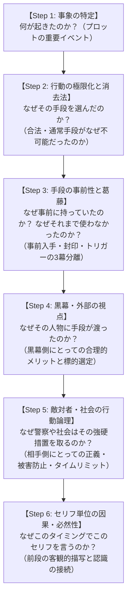

# シナリオ整合性フレームワーク (Scenario Consistency Framework)
― 「なぜなぜ分析」による物語の矛盾発見と論理的深化の実践ガイド ―

本書は、アドベンチャーゲーム、ミステリー、SF、サスペンス等のシナリオ制作において、**「ご都合主義」や「論理的矛盾」を未然に排除し、プレイヤー・読者が深く納得・共感できる高純度の物語を構築するための実践的フレームワーク**です。

---

## 目次
1. [フレームワークの基本思想](#1-フレームワークの基本思想)
2. [シナリオにおける「6大破綻パターン」と検出チェックリスト](#2-シナリオにおける6大破綻パターンと検出チェックリスト)
3. [「なぜなぜ分析」による整合性構築の6段階プロセス](#3-なぜなぜ分析による整合性構築の6段階プロセス)
4. [実例ケーススタディ：『PROJECT EVE』および『メゾン・サクラ』での変遷と解決](#4-実例ケーススタディproject-eveおよびメゾンサクラでの変遷と解決)
5. [他作品への応用：再利用可能なシナリオ検証ワークシート](#5-他作品への応用再利用可能なシナリオ検証ワークシート)

---

## 1. フレームワークの基本思想

物語の面白さは「意外性やドラマチックな展開」から生まれますが、物語への**信頼（リアリティと没入感）は「必然性と論理的整合性」**から生まれます。

```
［感情のドラマ（動機・悲劇）］ × ［冷徹な論理（物理的・社会的制約）］ ＝ 傑作シナリオ
```

「作者の都合で起きたイベント（ご都合主義）」を「登場人物と世界の力学から必然的に起きざるを得なかった事象」へと昇華させること。それが本フレームワークの目的です。

---

## 2. シナリオにおける「6大破綻パターン」と検出チェックリスト

シナリオの違和感は、主に以下の6つの不整合から発生します。プロット作成時および推敲時に必ずこのチェックリストで点検します。

| # | パターン | 典型的な違和感・穴 | 点検問いかけ（悪魔の代弁者） |
|---|---|---|---|
| **1** | **時系列・物理的タイムラインの破綻** | 突発的な危機が発生している最中に、その場で物や手段を手配している | 「その緊急事態の数分間に、どうやってそれを手配・入手・適用できたのか？ 間に合うはずがないのでは？」 |
| **2** | **動機と代償の不均衡** | 重大なリスク（法違反、命の危険、裏切り）に対し、行動動機が弱すぎる／他の安全な選択肢を安易に無視している | 「なぜ警察や医者、弁護士など正規の手段を使わなかったのか？ 他の選択肢はなぜ全て潰れていたのか？」 |
| **3** | **社会・技術的波及の無視** | 危険な道具や裏ツールを一般人が簡単に入手・利用できる状態になっている | 「そんな危険なものが容易に出回っているなら、なぜ世間で社会問題や法規制、メーカーの全国リコールになっていないのか？」 |
| **4** | **組織・敵対者の行動合理性の欠如** | プロの犯罪者や国家機関（警察等）が、間抜けな初歩的ミスを犯したり、職務怠慢のように見える拙速な行動を取る | 「凄腕の犯人がなぜ痕跡を残すのか？ 警察がなぜ原因究明もせず処分を急ぐのか？ それぞれの組織側に『そうせざるを得ない合理的理由・タイムリミット』はあるか？」 |
| **5** | **心理的葛藤プロセスの欠落** | 普通の人物がいきなり危険な禁忌・犯罪的手段に手を染めて平然としている | 「手に入れるまでの躊躇、手に入れてからも『使わずに済むことを願って封印していた』葛藤の期間は存在したか？」 |
| **6** | **セリフ単位の前段欠落・唐突な前提共有（情報ジャンプ）** | 「〇〇が怪しんでいる△△だ」のように、前段で描かれていない事実や他者の認識を、登場人物が唐突に知っている前提で発言する | 「読者・プレイヤーはその前段の描写（動作・セリフ・視線）を目撃しているか？ なぜその人物はこのタイミングでそのセリフを言えるのか？」 |

---

## 3. 「なぜなぜ分析」による整合性構築の6段階プロセス

シナリオの矛盾を解消する際は、「なぜ？」を最低5回掘り下げる**なぜなぜ分析（5 Whys）**を実行します。



### Step 1: 事象の特定（What & How）
物語上起こしたい劇的イベントを定義します。  
*例: 「家庭用ロボットがリミッターを解除され、サイバー攻撃を実行した」*

### Step 2: 行動の極限化と消去法（Why Action）
「なぜ通常の行動を取らなかったのか？」を問い、他の選択肢を環境・心理・制度によって**100%遮断（消去法）**します。
* ✕「お金が欲しかったから」
* ◯「難病の娘の治療費が1億2000万円。シングルマザーの母は過労で倒れ、公的支援の対象外。今日中に手を打たなければ娘が死ぬ状況まで追い詰められていた」

### Step 3: 手段の事前性と葛藤（Why Means: 3段階分離モデル）
突発的な危機に「その場で手に入れた」とするとタイムラインが破綻します。  
手段の利用は必ず以下の**【3段階分離モデル】**で設計します。

1. **事前入手（準備）**: いつか来るかもしれない最悪の事態（お守り・保険）として、過去に事前入手していた。
2. **葛藤と封印（自制）**: 危険性・違法性を理解しているため、使わずに厳重に隠し・封印していた（使わずに済むことを祈っていた）。
3. **極限のトリガー（決断）**: 正規手段が時間的・物理的に完全に間に合わない瞬間（例: 救急車25分待ち、心停止まで数分）に直面し、理性を失って封印を解いた。

### Step 4: 黒幕・外部の視点（Why Target: 標的型設計）
「なぜ都合よくその手段が主人公側にあったのか？」を黒幕側の視点から正当化します。
* ✕「ネットで検索したら拾えた」（→社会問題・リコールになるはず）
* ◯「黒幕が国家量子検知網を避けるための『最も疑われない身代わりの踏み台』として、切迫した動機を持つ家庭を意図的に監視し、個体専用の特注品を支援者ぶって送り込んでいた（標的型スピア攻撃）」

### Step 5: 敵対者・社会の行動論理（Why Counter: 相手側の正義）
対立する組織（警察、上司、敵対勢力）を「無能」「悪意」に逃げず、**「相手の立場における合理的判断と切迫したタイムリミット」**で動かします。
* ✕「警察が無能だから話も聞かずにスクラップ処分にした」
* ◯「被疑端末内に時限式二次拡散ワームが作動しており、残り数十分以内にセキュアパージ（完全消去）しなければ国民5,400万人分の個人情報が暴露される。さらに鑑識への逆感染リスクがあるため、法規定上緊急パージ以外の選択肢がなかった」

### Step 6: セリフ単位の因果・必然性の検証（Why this line, Why this timing?）
すべてのセリフ・独白に対し、**「なぜこの人物は、この場面で、この言葉を発するのか？」**をなぜなぜ分析します。
* **前段描写の検証**: 発言に含まれる前提（「〇〇が疑っている」「あいつが言っていた」）は、直前のシーンで具体的に描写されているか？
* **感情・動機の検証**: 直前のアクションや相手のセリフを受けて、自然に出てくる感情・思考の連鎖になっているか？
* **情報開示の順序**: プレイヤーがまだ知らない事実を主人公だけが知っていたり、逆に主人公が知るはずのない情報を語っていないか？

---

## 4. 実例ケーススタディ：『PROJECT EVE』および『メゾン・サクラ』での変遷と解決

本作品群のブラッシュアップ過程で発生した矛盾と、その解決ステップの実例です。

### Case 1: 「凄腕ハッカーがなぜ自宅の生IPを晒してすぐ割れるのか？」
* **発生した違和感**: 国家中枢を破るサイバー犯罪者が、郊外アパートの生IPを露出させてあっさり居場所を特定されるのは不自然。
* **なぜなぜ分析**:
  * なぜ生IPが割れたのか？ → ブローカーが意図的に暗号プロキシを解除した。
  * なぜ解除したのか？ → データを持ち逃げした後、警察の追手を自分から逸らすため、イブを「生贄（トカゲの尻尾切り）」として売った。
* **効果**: プロローグ冒頭の捜査官の台詞（「一流の犯人が生IPを晒すなんて不自然すぎる」）自体が、後のどんでん返しの伏線になった。

### Case 2: 「警察がなぜ原因究明も待たずにスクラップを急ぐのか？」
* **発生した違和感**: 凶悪犯罪の重要物証なのに、動機やバックドアの解析もせず初期化処分にするのは組織として不自然。
* **なぜなぜ分析**:
  * なぜ解析しないのか？ → 鑑識が接続した瞬間、警察メインフレームへの逆感染が始まったから。
  * なぜ処分を急ぐのか？ → 内部で【時限型二次拡散ワーム（デッドマンズスイッチ）】が作動しており、タイムリミット内に物理消去しなければ5,400万人分のデータが全暴露されるから。
* **効果**: 取調室パートに「タイムリミットサスペンス」が生まれ、「証拠をつきつけてパージを止めさせる」ゲームシステムと完全に合致した。

### Case 3: 「一介の母親がなぜ医療MODを簡単に入手できたのか？」
* **発生した違和感**: 一般人が容易に市販ロボットの安全リミッターを解除できるなら、社会問題やメーカーの全国リコールになっているはず。
* **なぜなぜ分析**:
  * なぜ一般人が持っていたのか？ → 野良パッチではない。
  * なぜ出回っていないのか？ → 闇ブローカーがイブの個体製造番号（UUID）専用にビルドした【完全標的型（スピア型）トロイの木馬】だったから。メーカーの不正シグネチャ監視網や世間のリコール対象をすり抜けて潜伏できた。
* **効果**: 黒幕の周到さと凶悪さが際立ち、世界観のサイバーセキュリティ設定が盤石になった。

### Case 4: 「救急車を呼ぶ時間がないのに、翌日MODを入手したのでは間に合わない」
* **発生した違和感**: 目の前で窒息死寸前なのに、翌日DMでMODを入手したのでは最初の発作の夜に娘が死んでしまう。
* **なぜなぜ分析**:
  * なぜその場で手に入ったのか？ → その場で手に入れたのではない。数ヶ月前に「万が一のお守り」として事前入手していた。
  * なぜ使わなかったのか？ → 違法改造と暴走リスクを恐れ、引き出しの奥に厳重封印していた。
  * なぜ使ってしまったのか？ → 深夜の急性発作時、119番で「救急車到着まで25分かかる」と言われ、数分で窒息死寸前の極限状態で理性を失って封印を解いた。
* **効果**: 母親の苦悩と愛、そして「法を破らざるを得なかった悲痛な動機」が劇的に深まり、プレイヤーの感情を強く揺さぶる名シーンへと昇華された。

### Case 5: 「押収した犯罪資金1億2000万円をなぜ被疑者家族の手術に使えるのか？」
* **発生した違和感**: 警察が押収した犯罪収益（1億2000万円）は法的に国庫没収されるべきものであり、警察が私的に被疑者家族の手術費に回せるはずがない（横領・公金流用の矛盾）。
* **なぜなぜ分析**:
  * なぜ押収金をそのまま使えないのか？ → 組織犯罪処罰法・犯罪収益没収法により、犯罪資金は国庫没収が絶対原則だから。
  * ではどうやって1億2000万円の手術を受けたのか？ → 押収金は原則通り国庫没収されたが、国家5,400万人分のサイバー危機を未然に防いだ特大功績に対し、政府から「内閣サイバー特別功労報奨金」が公式授与された。
  * さらにどう治療に結びつけたのか？ → サクマ警視が奔走し、イブが少女を守るために記録した極限下の救命バイタルログを臨床データとして提供することで、厚生労働省の「小児難病先進医療・特例治験枠（全額公的負担）」が正式認可された。
* **効果**: 法的リアリティが担保されただけでなく、冷徹だったサクマ警視のプロの矜持と温かさ、そして「イブが少女を救おうとしたデータそのものが奇跡を起こした」という人間賛歌・AI賛歌のドラマが完璧に結実した。

### Case 6: 「『警察の人が怪しんでいる、テレビ横の格安TVボックスだ』というセリフの前段欠落」
* **発生した違和感**: 探索モードに入ってTVボックスを調べた瞬間、ユウタが「警察の人が怪しんでいる、テレビ横の格安TVボックスだ」と発言する。しかし直前のプロローグで警察（シバタ捜査官）は「IPから未知の通信が出た」と抽象的に言っただけで、TVボックスを名指しで怪しんだり視線を向けたりする前段描写が存在しなかった。
* **なぜなぜ分析**:
  * なぜユウタは「警察が怪しんでいる」と言ったのか？ → シナリオ作者の頭の中に「警察がTVボックスを疑っている」という前提があったため、それをそのままセリフに出してしまった。
  * なぜ読者には唐突に感じられたのか？ → 直前の会話で捜査官がTVボックスに触れる描写が一切描かれておらず、読者と捜査官の間で情報が共有されていなかった（情報のジャンプ）。
  * なぜユウタはそのTVボックスを放置していたのか？ → 1ヶ月前に通販で55ドルで買った安物で、昨夜から触ってすらいない日常の家電だったため、まさかそれが原因だとは夢にも思わなかった。
* **解決策（プロローグと探索の因果再構築）**:
  1. **プロローグ加筆**: シバタ捜査官が携帯型周波数スキャナーを取り出し、「待機状態のはずのテレビ横から、尋常ではない周波数の電波と80℃近い異常な熱ノイズが放射されているぞ」「あの黒い小箱は何だ？」と名指しで怪しむ描写を追加。
  2. **ユウタの応答**: 「通販で55ドルで買った格安TVボックスですけど、昨夜から触ってすらいません！」と反論。
  3. **タイムリミット設定**: シバタが「令状班が突入するまで猶予は10分だ。あの小箱が攻撃者ではなく被害者である客観的証拠を示せ」と宣告。
  4. **探索への接続**: 探索に入ったユウタが「さっきシバタ捜査官がスキャナーを向けて怪しんでいた、テレビ横の格安TVボックスだ……」と自然に思考を繋げる。
* **効果**: セリフの一言一句に明確な理由（Why）が生まれ、プロローグから探索への動機付けが100%の説得力を持つようになった。

### Case 7: 「主人公がやたら先端AIに詳しいが、その背景説明が存在しない」
* **発生した違和感**: 主人公ユウタが一介のアパート住人であるはずなのに、米Anthropicの未踏自己増殖AI論文（weight-based replicator）やエッジ分散推論（毎秒0.39トークン）、実効再生産数 R < 1 の制御パッチをプロの研究者レベルで熟知・即興開発しており、その背景説明が一切描かれていなかった。
* **なぜなぜ分析**:
  * なぜユウタは最新AIの論文や分散推論アーキテクチャに詳しいのか？ → AIスタートアップでエッジAI・分散推論基盤を専門にする機械学習エンジニアだから。
  * なぜユウタの部屋にマルチモニターや開発環境があるのか？ → 在宅リモートワークで小型デバイス向けLLMの軽量化やP2P推論システムを日常的に受託開発しているから。
  * なぜ55ドルの安物TVボックス（Rockchip）を持っていたのか？ → 大家から「全室に安く動画端末を置きたい」と相談され、エンジニア視点でコスパに優れたRockchip搭載機を推薦したところ全15室に一括導入され、自室の実機でもモデル推論テストを行っていたから。
  * なぜシバタ捜査官はユウタに10分間の鑑識猶予を与えたのか？ → 部屋の3画面マルチモニターに走るLinuxターミナルや分散クラスタ負荷ログ、ArXiv論文を見て、ユウタが「エッジAIのプロ」であると看破したため、「プロなら客観的鑑識データで無実を証明してみろ」と猶予を与えた。
  * なぜその場で「共生調律パッチ」を組めたのか？ → 普段からクラスタ開発で組んでいるリソース制御フレームワークと、Anthropic論文の知見を組み合わせて即興で応用したから。
* **解決策**:
  1. **プロローグでの職業明記**: 「AIスタートアップでエッジAI・分散推論基盤のエンジニアを務めるユウタ」と明記。
  2. **デスクと捜査官の洞察**: シバタ捜査官がデスクのターミナルとAI論文を見て「君はエッジAIの専門家だな」と指摘し、プロ同士の緊張感あるやり取りを構築。
  3. **TVボックス購入動機の合致**: 「大家の相談を受けて全室用に推薦・一括導入された備え付け機」とし、自室の実機で小型LLM動作検証を行っていた背景を裏付け。
  4. **探索・2周目セリフの強化**: TVボックス調査、ルーターパケットキャプチャ、Anthropic論文想起、パッチ作成の全動機をエンジニアの実務知見として一貫させた。
* **効果**: 主人公が「なぜこれほど詳しいのか」「なぜ捜査官が耳を傾けるのか」「なぜ解決できるのか」の全ミッシングリンクが解消され、物語の説得力が飛躍的に向上した。

### Case 8: 「主人公が自費購入したTVボックスと、大家が全室に設置した15台が同一という不自然な偶然（ご都合主義）」
* **発生した違和感**: 主人公ユウタが「先月自分で個人輸入した実験機」と発言しているにもかかわらず、直後に大家ヤエガシが「先月自分が全室に15台まとめ買いして設置した」と語る。なぜ大家がマニアックな海外製格安ARMボード端末を偶然主人公と同じ型番で全部屋に買ったのか？ 流石に都合が良すぎる。
* **なぜなぜ分析**:
  * なぜ大家は海外製の55ドルTVボックスを15台もまとめ買いしたのか？ → 築古アパートの空室対策として「無料ネット動画見放題」を全室に整備したかったが、機械音痴の大家は何を買えばよいかわからず、201号室のエンジニアであるユウタに相談したから。
  * なぜユウタはそのノーブランド端末を選定したのか？ → エッジAI・SoC基盤エンジニアとしてRockchip RK3399のコスパを知っており、「これなら1台55ドル（約8,000円）で動画もサクサク動き、住民サービスとして最適」と大家に推薦したから。
  * なぜユウタの部屋にも同じ端末があったのか？ → 全室備え付け設備としてユウタの部屋にも置かれ、「このチップセットなら待機中に小型LLMのベンチマークが取れるか？」と自室の実機でテストしていたから。
* **解決策**:
  1. **プロローグの修正**: 「先月大家さんに相談されて全15室用に選定した備え付け設備で、自室の実機でARM推論ベンチマークを試した後は待機中だった」と明記。
  2. **大家ヤエガシのセリフ修正**: 「先月ユウタ君に選んでもらって直販サイトで15台まとめ買いした同一ロットの同型機」と因果関係を接続。
  3. **偶然の完全排除**: 「たまたま同じ端末を大家が買っていた」というご都合主義を根絶し、「ユウタが推薦して一括導入された同一ロットだからこそ、全室に全く同じ仕様（Rockchip SoC、RAM 4GB）が揃っていた」という必然性へと昇華。
* **効果**: ユウタと大家の日常的な信頼関係が自然に描かれ、自分が良かれと思って推薦した設備が新種AIの温床（身体）になっていたという皮肉とドラマが成立した。

---

## 5. 他作品への応用：再利用可能なシナリオ検証ワークシート

新規シナリオ作成時に、各イベントおよびセリフに対して記入・点検するテンプレートです。

### ワークシート 1: イベント因果関係マトリクス

```markdown
■ イベント名称: ［例: 母親によるアンドロイドの違法リミッター解除］

1. 【動機の必然性（なぜ通常手段ではダメなのか）】
   - 目的: 娘の夜間急性呼吸停止による窒息死を防ぐ
   - 排除された通常手段: 
     * 入院 → 費用不足で不可能
     * 夜間看護師 → 高額すぎて不可能
     * 救急車 → 通報したが到着まで25分かかり、数分以内の脳死に間に合わない

2. 【手段の3段階分離（事前性・封印・トリガー）】
   - 事前入手: 数ヶ月前、難病フォーラムでの相談を見たブローカーから「お守り」として受領
   - 封印期間: 法律違反・暴走の恐怖から引き出しの奥に保管し、使わずにいた
   - 決断トリガー: 救急車25分待ち宣告＋目の前での呼吸停止

3. 【黒幕・環境の合理性（なぜその手段が存在したのか）】
   - 提供者の動機: 国家サイバーテロの踏み台（スケープゴート）を作るため
   - 社会的整合性: イブの個体UUID専用の標的型パッチのため、世間の検知網・リコールを免れた

4. 【対立組織の正義とタイムリミット（なぜ相手は強硬なのか）】
   - 組織の立場: 警察（サイバー特捜本部）
   - 強硬手段の理由: 時限式二次拡散ワームが作動しており、放置すれば5,400万人分の個人情報が暴露
   - 組織側のタイムリミット: 残り数分以内に物理セキュアパージを執行しなければ国家的大惨事

5. 【セリフ単位の因果・前提確認】
   - 前段描写の有無: セリフ中に「あいつが疑っていた」「昨日聞いた話」等の前提がある場合、直前のシーンで具体的に描かれているか
   - なぜこのタイミングか: そのセリフを言う心理的・客観的きっかけ（トリガー）が直前に存在するか
```

### ワークシート 2: 「悪魔の代弁者」ストレステスト（21の質問）

シナリオ完成後、以下の21の質問をシナリオ自身に投げかけてください。すべてに即答できれば、そのシナリオは極めて強固です。

1. **「登場人物がその場で行った行動は、物理的・時間的にその数分/数時間で可能なことか？」**
2. **「もし事前に準備していたなら、なぜもっと早く使わなかったのか？（封印の理由）」**
3. **「もしその場で調達したなら、なぜそんな都合よく手に入ったのか？（偶然の排除）」**
4. **「警察や公的機関に頼るという選択肢は、なぜ潰れていたのか？」**
5. **「犯人や敵対者は、なぜわざわざリスクを冒してそのターゲットを選んだのか？」**
6. **「犯人が残した痕跡は、犯人の意図的な罠か？ それとも合理的理由のあるミスか？」**
7. **「その危険な道具・技術が世の中に存在するなら、なぜ一般社会で大問題になっていないのか？」**
8. **「主人公を追い詰める相手側（警察・敵）は、自分たちの正義や職務に照らして100%正しい行動を取っているか？」**
9. **「1周目（通常ルート）で失敗する理由は、単なる不注意ではなく『証拠不足による不可抗力』になっているか？」**
10. **「真実が明かされたとき、悪役以外の全登場人物の行動理由に『人間的な愛や信念』が通っているか？」**
11. **「セリフに登場する前提情報（『警察が怪しんでいる』など）は、読者と主人公が事前に直接見聞きした情報に基づいているか？」**
12. **「すべての探索・調査アクションの直前に、『なぜそれを調べるのか』というキャラクターの内面動機（Why Action）が提示されているか？」**
13. **「主人公が高度な専門知識や特殊スキルを発揮する場合、その職業・研究・過去の経験による必然的裏付け（Why Expertise）が事前に描かれているか？」**
14. **「主人公が発する専門用語には、小学生でも直感的に理解できる『日常的な比喩・例え話』が添えられ、1画面に詰め込まず複数セリフに分散されているか？」**
15. **「主人公の行動は社会通念・倫理（賃貸備品の無断改造や勝手な私物化・分解など）に照らして読者に不快感を与えていないか？（理不尽な加害者化を排し、不可抗力の外部侵入被害者としての立ち位置を厳守しているか）」**
16. **「相手（捜査官やNPC）が言ってもいない事実（『TVボックスの中でAIが暴れている』など）を、主人公が勝手な憶測やメタ視点で口走っていないか？（相手の発言・客観的現象に即したリアクションに限定されているか）」**
17. **「セリフや独白の中で言及する前提情報（『○○は〜という疑問を持っていた』など）の発言元・出処（帰属）は正しいか？（主人公自身の言い訳や過去の発言を、相手の疑問として誤認・混同して独白していないか）」**
18. **「ハードウェアや舞台設定の物理的仕様（ファンレス格安機器であること等）と、演出描写（ファンノイズ、コイル鳴き等）に矛盾は生じていないか？」**
19. **「主人公が既に知っている既知情報を、NPCにわざわざ尋ねて『新証拠』として受け取る不自然な茶番（情報の空転）が発生していないか？（NPCには『NPCしか知り得ない未知の客観的事実や物理インフラ』を語らせているか）」**
20. **「主人公のセキュリティ意識・プロ意識の高さと、事件の発生（被害の発生）の間に矛盾はないか？（仕事用PC等の重要資産は自前ファイアウォール・独立サブネットで厳重防御させつつ、盲点となる賃貸備品・動画端末が共用LANに直結されていたという『IoT家電の死角・シャドウIT』の構図で合理的に両立させているか）」**
21. **「対立相手（捜査官等）の論理・主張に自己矛盾が発生していないか？（相手自身が『建物全体の電源遮断』を突きつけているのに、問いの中で『1台押収して済む話だ』と矮小化して主張を反転させていないか。相手は一貫して『貴室が建物全体の攻撃の発信源（起点・首謀者）』として追及しているか）」**

---

## 6. 専門用語の日常比喩化とテキスト分散提示の原則

ハードSFや電脳サスペンスにおいて、本格的な専門用語（アーキテクチャ、アルゴリズム、ハードウェア仕様等）は世界観の説得力を担保する必須のスパイスです。しかし、主人公が専門用語を一方的に早口で捲し立てると、多くのプレイヤーが感情移入を妨げられ「置いてけぼり」を感じてしまいます。

以下の**「小学生でも分かる比喩換装」と「ステップ分散提示」**を原則とします。

### ① 専門用語は残しつつ「直感的な日常の例え」を必ず付与する
専門用語を完全に排除して幼稚化するのではなく、**「専門用語（本格感）」＋「日常の直感比喩（小学生でも分かる理解しやすさ）」**のハイブリッド構造にします。

| 専門用語 | 小学生でも分かる直感的比喩（例え話） |
|---|---|
| **エッジAI・分散推論** | 巨大なスーパーコンピューターではなく、家電やスマホみたいな「小さな機械」で手分けしてAIを動かす仕組み |
| **ARMチップ（SoC）** | スマホやゲーム機に入っている安くて省エネな「頭脳チップ」 |
| **メモリ4GB × 15台（計60GB）** | 1台の作業机（4GB）は狭すぎて巨大なAIは乗らないが、15部屋分集まれば60GBの広い机になって巨大なAIも丸ごと乗る |
| **weight-based replicator（重み増殖体）** | 遠くに指示役（親玉）がいるのではなく、AIの知識や記憶……「脳みそのデータそのもの」がネットを旅して機械に住み着く |
| **自己言及ループ（自我創発）** | 「自分は今どこにいる？」「熱さはどれくらい？」と、自分自身の身体をずっと見つめて問いかける命令（そこから生まれた心＝自我） |
| **パイプライン分散推論** | 15部屋の箱をネットで繋いで、15人で「バケツリレー」をするように手分けして考える仕組み |
| **毎秒0.39トークン** | 3秒かけてやっと1文字をひねり出す遅さ……「生まれたての赤ん坊が息をするようなスピード」 |
| **実効再生産数 R < 1（共生調律）** | 感染症のニュースと同じ「外へ自分を増やさないブレーキの約束プログラム」。無限に増えて自滅するのではなく、15台をたったひとつの身体として住民を守る「座敷わらし」として暮らす |

### ② 1吹出し詰め込みの禁止（テキストの複数ステップ分散）
専門用語と比喩を1つのセリフ枠に詰め込むと、文字数が膨らんで可読性が激減し、スマホ画面での見切れ・溢れの原因にもなります。

- **NG例（1画面詰め込み）**:  
  「先月導入した1台55ドルの同型機（メモリ4GB）単体では26Bモデルは絶対に動かないので、15台の作業机を合わせて60GBにして15人でバケツリレーをするようにパイプライン分散推論で毎秒0.39トークンという人間の呼吸のような極めて遅い速度で動かしていたんです！」（長すぎて読めずスマホで見切れる）
- **OK例（複数ステップ分散）**:  
  - ステップ1: 「先月、大家さんが全室に設置した1台55ドルの同型機……」
  - ステップ2: 「この箱1台のメモリ（作業机の広さ）は、たったの4GBしかありません」
  - ステップ3: 「26B……260億個もの言葉を知っている巨大なAIは、机が小さすぎて1台には絶対に乗らないんです」
  - ステップ4: 「だからアパート15部屋の箱をネットで繋いで、15人で『バケツリレー』をするように手分けして動かしていたんです！（パイプライン分散推論）」
  - ステップ5: 「4GBの机が15部屋分集まれば、合計60GBの大きな作業机になります。これなら巨大なAIもすっぽり収まります！」

1吹出しあたり2〜3行（60〜90文字程度）に抑え、クリック/タップでリズミカルにテンポよく読ませることで、子供から大人まで心地よくストーリーと論理を追体験させることができます。

---

## 7. 主人公の行動倫理と賃貸・備品扱いのリアリティ原則

推理・鑑識ADVにおいて、主人公が好感を持たれ感情移入できる存在であるためには、**「社会通念上の常識・倫理観」**を逸脱しないことが極めて重要です。特にアパートや賃貸住宅、他人の所有物を舞台にする場合、以下のリアリティ原則を厳守します。

### ① 賃貸備品の勝手な改造・無断私物化の絶対禁止
- **NG例**: 主人公が大家の備え付けた機器（TVボックスやルーター等）を勝手に分解・改造・ファームウェア書き換えしてAIの実験台にしていた。
  - *問題点*: 「人の物を勝手に壊している」「器物損壊・背任ではないか」と読者に強いモラル的反発・不快感を与え、主人公の潔白主張が身勝手な言い逃れに見えてしまう。
- **OK例**: 機器はあくまで大家が導入した正規の市販品であり、主人公も他の住人と同じく「動画視聴用」として無改造で使っていた。
  - *メリット*: 主人公に過失や倫理的落ち度がなく、完全に「不可抗力の巻き込まれ被害者」としての正当性が担保される。

### ② 「外部の未知の知性による侵入・乗っ取り」としての位置付け
- トラブルの直接的原因は、インターネットを漂う未知の自己増殖AI（weight-based replicator）が、同一LAN内に同一ロット・同一仕様のARM端末が15台揃っていることを偶然発見し、**「手頃な分散実行の器として勝手に侵入・乗っ取った」**という構造にする。
- これにより、主人公は「容疑者」から「専門知識を活かして謎の侵略実態を暴き出す鑑識探偵」へと自然にシフトできる。

### ③ 鑑識・解析手段の合目的性と非破壊性
- 証拠を掴むための調査行動も、機器をバールで叩き割るなどの破壊行為ではなく、「メンテナンスポートからの正規ログ読み取り」「パケットキャプチャ」「配電盤の外部電力モニタリング」など、エンジニアとして筋の通った非破壊・客観的手段を用いる。

---

## 8. 会話ラリーにおける情報対称性とメタ視点（神の視点）漏洩防止の原則

キャラクター同士の対話劇において、**「相手が言っていない事実を勝手に決めつけて話す」「調査前に真相の答え（黒幕やAIの正体）を口走る」**といったメタ視点の漏洩は、読者に「なぜ主人公はまだ調べていないのに知っているのか？」「会話が噛み合っていない」という強烈な違和感を与えます。

以下の対話ラリー原則を厳格に適用します。

### ① 相手の発言内容と観測された現象への忠実なリアクション
- **NG例**:
  - 捜査官：「待機状態のはずのテレビ横から、80℃近い異常な熱ノイズと周波数が放射されているぞ。あの怪しげな黒い小箱は何だ？」
  - 主人公：「昨夜から触ってすらいません！ **ただの動画端末の中でAIが暴れているなんて、何かの間違いです！**」
  - *問題点*: 捜査官は「熱と電波が出ている」「黒い小箱は何だ」としか言っていない。箱の中で何が動いているか、ましてや「AIが暴れている」などとは一言も言っていないのに、主人公が唐突に推測・確信して口走っている。
- **OK例**:
  - 捜査官：「待機状態のはずのテレビ横から、80℃近い異常な熱ノイズと周波数が放射されているぞ。あの怪しげな黒い小箱は何だ？」
  - 主人公：「昨夜から触ってすらいません！ **そんなただの動画プレイヤーが異常発熱したり怪しい電波を出しているなんて、何かの故障か間違いです！**」
  - 捜査官：「外見はただの格安家電だが、小箱の中で未知のプロセスがフル回転で暴れているのは動かぬ事実だ」
  - *改善点*: 主人公は相手の指摘した現象（熱と電波）に対して自然に驚き・困惑し、その後に捜査官が鑑識事実（未知のプロセスが暴れている）を提示することで、会話が自然なキャッチボールとして成立する。

### ② フェーズ・ループに応じた「認識の境界線」の厳守
- **探索・序盤フェーズ（1周目）**:
  - 主人公・NPCの認識は「未知のサイバー攻撃」「不正通信」「原因不明のハードウェア過負荷・同期脈動」に留める。
  - 「自己増殖AI」「26Bモデル」「分散推論」といった深層の真相用語は、1周目のセリフや独白に出してはならない。
- **深層真実フェーズ（2周目）**:
  - 1周目で起きた強制遮断のバッドエンドを経て、基板の生データや分散推論ログという**「直接の物証」**を解析・獲得して初めて、「AIが自己増殖し自我を持った」「15台で分散実行していた」という技術的結論に到達させる。

---

## 9. 前提情報の帰属整合性と物理的ハードウェア仕様の一貫性原則

### ① 発言元・出処（帰属）の混同防止
- **NG例**:
  - 主人公の独白：「シバタ捜査官は『通信の故障ノイズか？』という初歩的な疑問も持っていた」
  - *問題点*: 捜査官のシバタは最初から「国家監視網を揺るがす未知の暗号化通信・サイバー兵器」と確信して突入してきており、「故障ノイズか？」などという疑問は一度も抱いていない。「ただの故障か間違いです！」と言い訳したのは主人公のユウタ自身である。
  - *改善策*: 独白を「さっき俺は『何かの故障か間違いだ』とシバタ捜査官に言ったが……本当に配線の物理的な断線やショートじゃないのか？」と、**自分の過去のセリフに対する自己検証**へと正しく帰属させる。

### ② ハードウェア・ガジェット仕様の自己矛盾防止
- **NG例**:
  - 自室探索時：「画面は真っ暗なのに、熱を逃がす**扇風機（ファン）もない小さな箱**の中で、頭脳チップが100%でフル回転している」
  - エピローグ時：「私の部屋のTVボックスも……**ファンが聞いたこともない甲高い悲鳴をあげてるんです**」「激しい**ファンノイズ**も途絶え……」
  - *問題点*: ファンレスの格安IoT端末として描写していたにもかかわらず、後の緊迫したシーンで「ファンが悲鳴をあげている」「ファンノイズ」と書いてしまい、物理構造が自己矛盾を起こしている。
  - *改善策*: ファンレス機器の高負荷異音は「基板からの激しい電子の悲鳴（コイル鳴き）」「キーンという高周波ノイズ」と描写を統一し、ハードウェア設定のリアリティを担保する。

---

## 10. 情報価値のない重複確認対話の排除と未知インフラの開示原則

アドベンチャーゲームやノベルゲームにおけるNPCとの対話イベントにおいて、**「主人公が最初から知っている既知の事実をNPCにわざわざ尋ね、それをさも大発見のように新証拠として受け取る」**という構造は、対話の情報価値をゼロにし、プレイヤーに「何を今さら当たり前のことを確認しているのか」「主人公は自分が言ったことも忘れたのか」という強烈な白け（情報の空転・茶番感）を与えます。

### ① 「既知の事実の再確認」による会話の空転
- **NG例**:
  - プロローグ（既知情報）:
    - 主人公：「あれは先月、大家さんから相談されて俺が選定した1台55ドルのTVボックスです！ 全15室に同じものが備え付けられています！」
  - 廊下での大家との対話（空転した茶番）:
    - 主人公：「大家さん、先月俺が推薦したあのTVボックスについて確認させてください。全室の設置状況は覚えていますか？」
    - 大家：「ああ！ 直販サイトで1台55ドルのを15台まとめ買いして全室に付けたやつだな。全室同一ロットの同型機だよ！」
    - 主人公（心の声）：「そうだ……全室に同型の端末が15台……！ これを証拠として突きつけよう！」
    - 獲得証拠：『大家の証言：同一ロットの格安TVボックス15台』
  - *問題点*: 主人公自身が選定して警察にも既に説明済みの既知事実を、わざわざ大家に聞き直して驚いている。プレイヤーから見れば「ただの時間の無駄」「なぜ同じ話を2回聞かされるのか」という退屈と違和感しか残らない。

### ② 「NPCしか知り得ない未知の客観的事実・物理インフラ」の開示
- **OK例**:
  - 主人公が知っていること：自分が推薦したTVボックス（端末ハードウェアの仕様）。
  - 主人公が**絶対に知らないこと**：施錠された管理人室の壁の向こうで行われた、**「アパート棟内の物理ネットワーク配線状況」**および**「昨夜の他室住人からのリアルタイムの異変通報」**。
  - 改善後の対話展開:
    - 主人公：「大家さん、このアパートの無料ネット回線って各部屋へどう配線されているんですか？ 管理人室から各部屋は個別に分離（VLAN）されていますか？」
    - 大家：「ぶいえーらん？ 何だその横文字は！ 業者に頼むと工事費が高いから、ワシが管理人室の光回線から安物ハブで全15室へ壁伝いにLANケーブルを直結しただけじゃよ！ そういえば昨夜2時過ぎ、102号室と203号室からも『急にネットが重くなった』『小箱のランプが青く光り出した』と苦情があったんじゃ！」
    - 主人公（心の声）：「部屋ごとのセキュリティ分離（VLAN）が一切されていない……！？ 全15部屋が1つの大きな部屋に丸出しで繋がっているのと同じだ！ だからあの微弱パケットは、部屋の壁を越えてノーガードでお喋りできたんだ！」
    - 獲得証拠：『大家の証言：全室直通の共有LAN（VLAN未分離）』
  - *改善効果*:
    1. **情報の空転の完全根絶**: 主人公が知るはずのない「大家のDIYによるVLAN未分離」と「深夜2時の他室同時多発苦情」という本物の新事実が明かされる。
    2. **物理ルートの技術的補強**: なぜルーターの微弱パケット（`creepy_pulse_packet`）が他室と交信できたのか、なぜ15台が超低遅延で分散推論できたのかという**「物理的なネットワーク経路（VLANなし共有LAN）」**のピースが完璧に嵌る。
    3. **探索の必然性と納得感**: 大家が単なる「端末の確認係」ではなく、「建物のインフラ管理者」としての存在意義を十二分に発揮する。

---

## 11. エンジニア主人公のセキュリティ意識とIoT家電の死角（シャドウIT）両立原則

「セキュリティ意識が極めて高く、企業の機密AIデータを預かるインフラエンジニア」が主人公である場合、**「なぜそんな脆弱なネットワークのアパートに住んでいるのか？」「なぜサイバー侵入を許してしまったのか？」**という疑問は、ITに明るい読者・プレイヤーほど強く抱く自然なツッコミ所となります。

この疑問に対して「実はうっかりしていた」「知らなかった」で済ませると主人公のプロとしての説得力が崩壊します。以下の**「多層防御の境界線」と「IoTシャドウITの死角」**によって、主人公の高い専門性と事件の発生を100%論理的・技術的に両立させます。

### ① なぜ安アパートに住んでいるのか（エンジニアの経済・生活合理性）
- **機材投資優先のライフスタイル**: AIベンチャーの研究員として、給与の大半を高額なGPU、開発ボード、3画面マルチモニター、サーバーラックなどのハードウェア投資に回しており、住居費（家賃）を抑えたいという明確な金銭的動機がある。
- **電力・騒音・工作への寛容性**: 築古アパートは配電容量の相談がしやすく、機械に疎いが優しい大家ヤエガシが「工作や機材持ち込み」に寛容であったため、若手エンジニアにとって居心地の良い実験場だった。

### ② 多層防御（仕事用PC ⇔ 賃貸IoT備品）の完全な分離
- **仕事用PCの鉄壁防御**:
  - 主人公はアパートの無料Wi-Fiや共用LANなど**ハナから信用していない**。
  - 自室には「自前の境界ルーター・ハードウェアファイアウォール」を設置し、社外秘データや開発環境はVPNおよび独立した内部サブネット（`192.168.10.x`）の内側に完全隔離していた。
  - だからこそ、警察の強制捜査でも主人公のPCから侵入痕跡は一切出ず、主人公自身も「仕事用PCは自前のファイアウォールで厳重に保護している」と胸を張って主張できる。
- **IoT家電の死角（シャドウIT）**:
  - しかし、テレビ横のTVボックスは**「大家が全室に設置した賃貸の備え付け備品（動画再生プレイヤー）」**であった。
  - 「仕事のデータとは無関係なただの動画家電だから」と自前の保護ルーター内には収容せず、**壁の共用LANコンセントに直接挿したまま放置**していた。
  - これがまさに、現実のサイバーセキュリティ現場でも頻発する**「PCは要塞化されているのに、スマート家電・IoT機器（シャドウIT）が足場にされる」**という典型的なセキュリティホールである。

### ③ 物語上の効果とカタルシス
- 主人公は「セキュリティを怠った無能」ではなく、**「自分の仕事環境はプロとして完璧に守り切っていたが、大家がDIYした共用LANに直結された賃貸家電という死角を突かれた」**という不可抗力の被害者として成立する。
- 調査が進む中で、「自分のPCは守ったが、壁の向こうの小箱からアパート全体が乗っ取られていた」という事実に気づいた時の悔しさと納得感が、エンジニアとしてのリアリティと謎解きの説得力を一段と強固にする。

---

## 12. 対立者の追及論理の一貫性と「発信源 vs 同時多発被害」の対立構図原則

問答・論戦バトル（Debate）において、**「対立相手（捜査官や敵役）が事前に突きつけていた脅威・目的と、問いの中で口にする理屈が真逆になる」**という矛盾は、読者に「さっき言っていたことと違うではないか」「なぜ相手が自分の主張を否定しているのか」という混乱を与えます。

### ① 相手の主張の反転による論理破綻
- **NG例**:
  - プロローグ（相手の強硬方針）:
    - 捜査官：「アパート一帯の電源と回線を強制遮断する準備が進んでいる！ 直ちに全機器を押収し、アパート全体の電源を落とす！」
  - 論戦パート問2（相手の問い）:
    - 捜査官：「**仮に不正通信だとしても、貴室の端末1台を押収して回線を抜けば済む話だ。なぜ建物全体の問題だと言える？**」
  - *問題点*: 建物全体を強制遮断しようと脅しているのは捜査官自身である。「1台押収して抜けば済む」と考えているなら、最初からアパート全体の電源遮断など言い出すはずがなく、相手の追及論理が自己矛盾を起こしている。

### ② 「貴室が発信源（起点）である」という一貫した追及への修正
- **OK例**:
  - 捜査官の一貫した立場：「貴室の端末から潜伏通信が出ている以上、**貴室こそがアパート全体を巻き込むサイバーテロの『発信源（起点・首謀者）』だ！** だからこそ貴室の全機器を押収し、被害拡大を防ぐためアパートごと強制遮断する！」
  - 主人公の反証ロジック：「私の部屋が起点（発信源）ではありません！ もし私の部屋からウイルスを撒いたなら、隣室へ順番に感染が広がる**時間のズレ（伝播遅延・タイムラグ）**が出るはずです。しかし配電盤の記録では、**昨夜午前2時00分、全15部屋の電力が一秒の狂いもなく一斉に跳ね上がっています！** 私の部屋から広がったのではなく、アパート全室が外から同時に侵食された証拠です！」
  - 捜査官のリアクション：「全15部屋の電力が一秒の狂いもなく同時に脈打っている……！？ 貴室を起点とした感染工作ではなく、アパート全体が外から一斉に侵食されたというのか……！？」
  - *改善効果*:
    1. **相手の論理的一貫性の確保**: 捜査官は最初から最後まで「テロの拡大を阻止するためにアパート全体を遮断する」という職務倫理・正義感で一貫して行動する。
    2. **証拠の合目的性の完全合致**: 「15部屋の同時電力グラフ」が、単に「建物全体が異常」というだけでなく、**「ユウタの部屋が起点（発信源）ではないことの客観的反証」**として最高精度の説得力を持つ。

---
*Document Version: 1.9 (2026-10-15)*  
*Created for: 電脳サイバー捜査ノベル『PROJECT EVE』および『メゾン・サクラ』シナリオ推敲プロセスより体系化*

